# TÍCH — On-chain term deposits

<p><a href="README.md"></a>&nbsp;<a href="README.en.md"></a></p>

TÍCH is an on-chain term-deposit system: depositors put in MockUSDC, receive an NFT certificate (ERC-721) and earn simple interest at the APR fixed when the deposit is opened. Depositors can top up principal (C4), settle at maturity, withdraw early in part (C3) or in full, claim deferred interest when the vault is short (C1), or renew into a new term.

The React + TypeScript interface connects to injected wallets through EIP-6963 (MetaMask is the default; Rabby, Coinbase Wallet, Brave and other injected wallets also work), reading from and writing to the three contracts on Sepolia. After connecting, balances, plans and deposits are all read from chain; while the RPC is pending, the interface shows a loading state. Every connected wallet gets a **Get test USDC** field on the plans and deposits pages and chooses its own amount: `MockUSDC.mint` is public and uncapped, so anyone can fund themselves — only Sepolia ETH for gas is required.

> **Design note — MockUSDC deliberately has no ownership.** The contract does not inherit `Ownable`, has no `owner`, no roles and no supply cap: `mint` is open to any address, for any amount, as often as you like. That is intentional, so a stranger can faucet the demo without an admin handing out tokens. The trade-off is that issuance can never be revoked or capped, which makes this token **testnet only**. A real token needs access control, a supply cap and a controlled issuance path.

## Screens

<p align="center">
  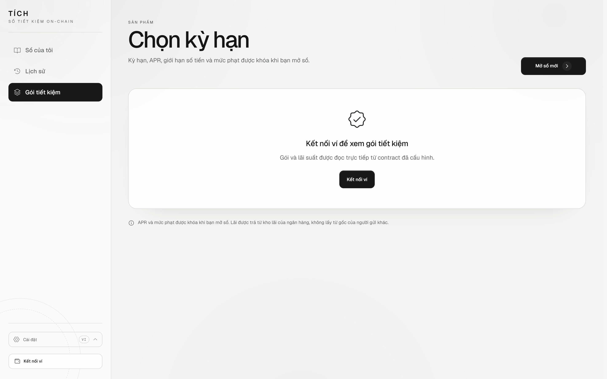
  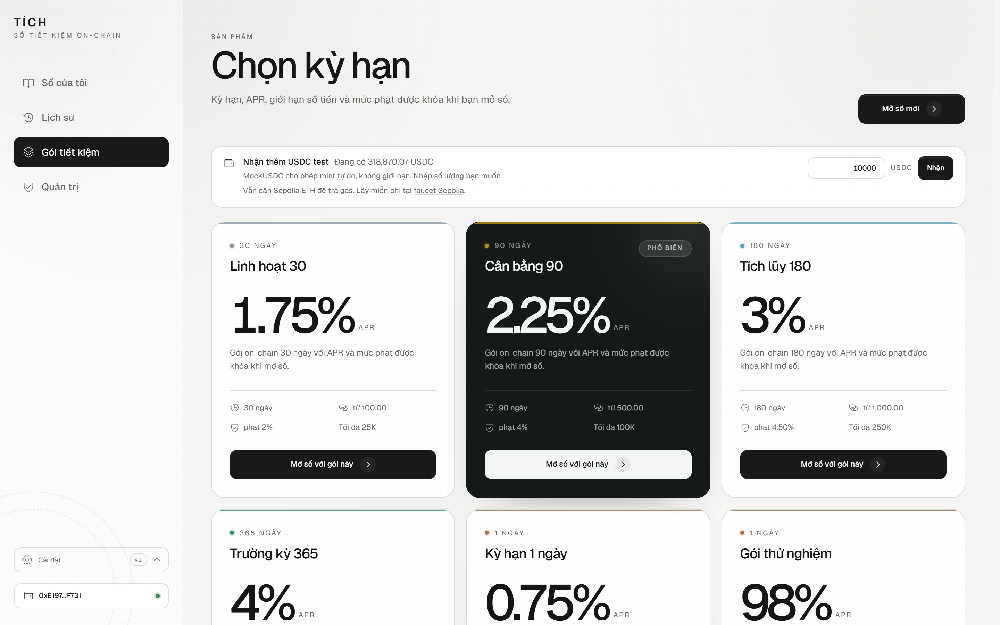
  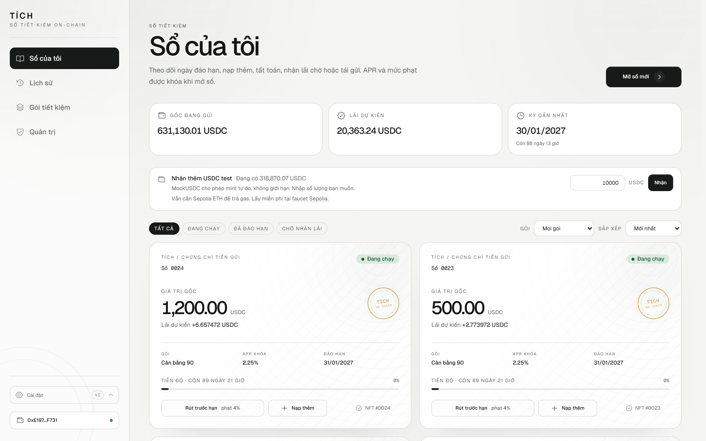
</p>

<p align="center">
  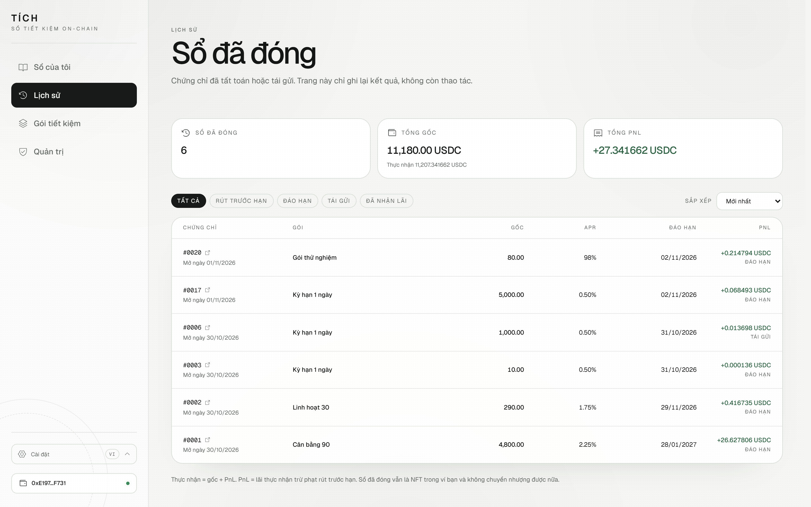
  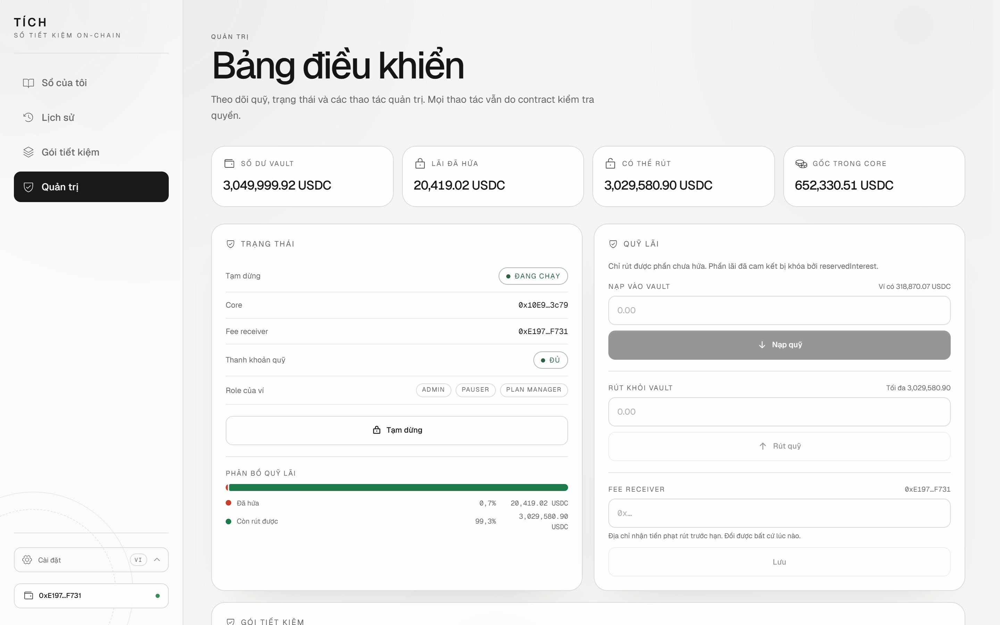
  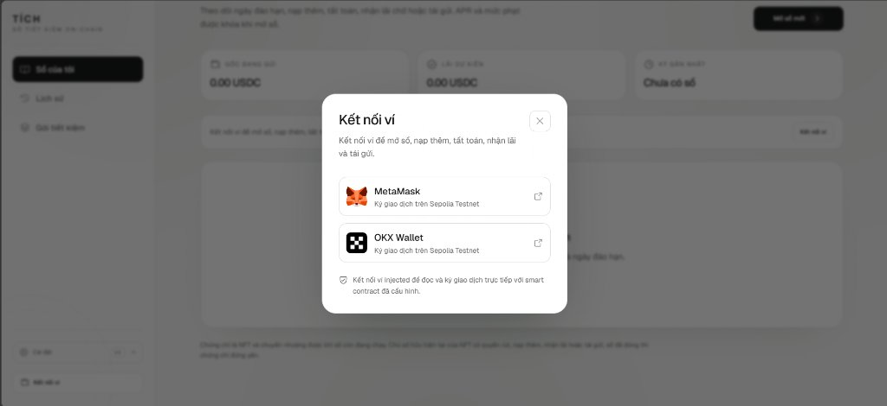
</p>

<p align="center">
  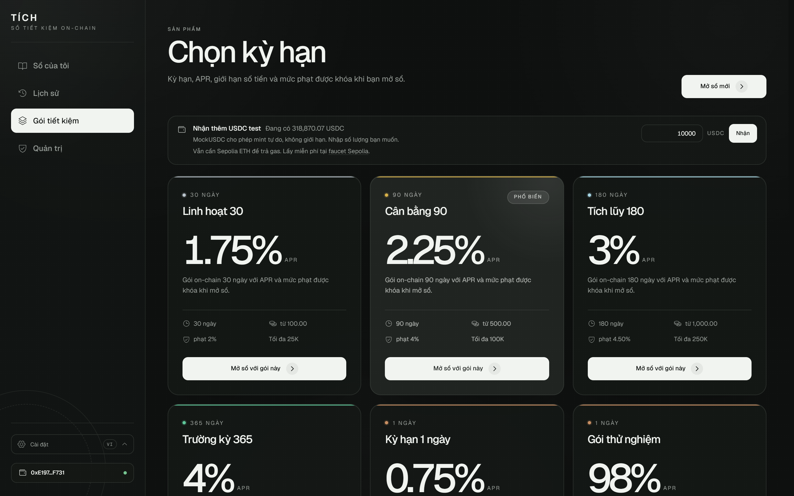
  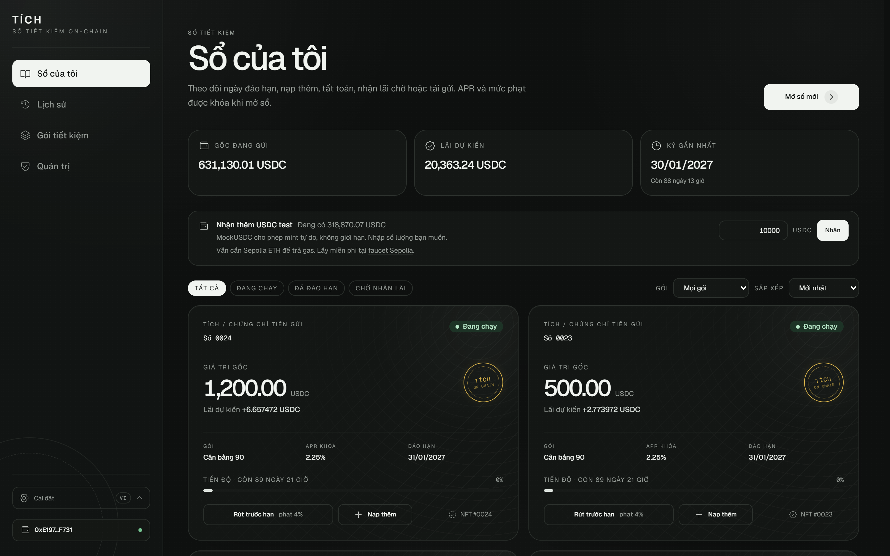
  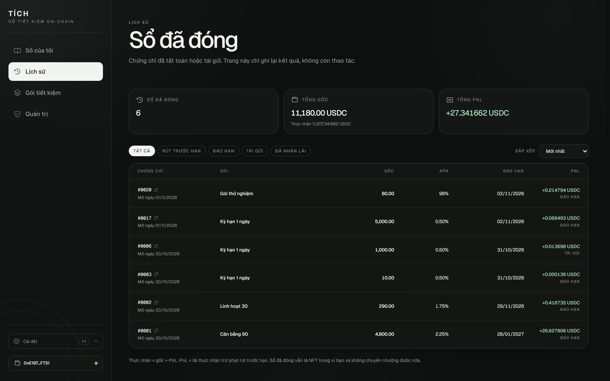
</p>

<p align="center">
  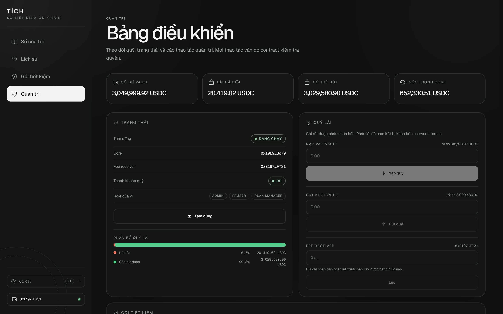
  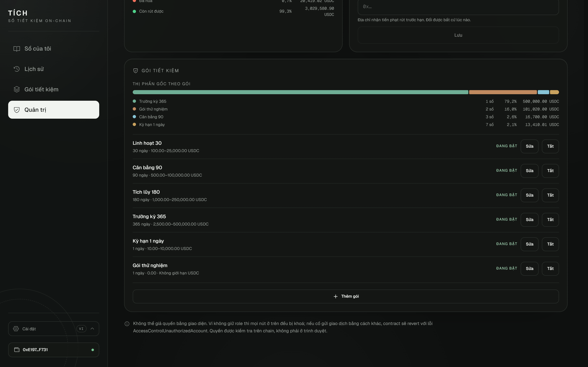
  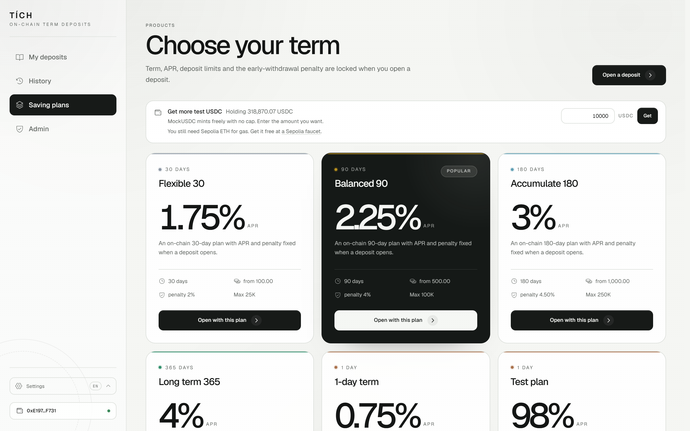
</p>

<p align="center">
  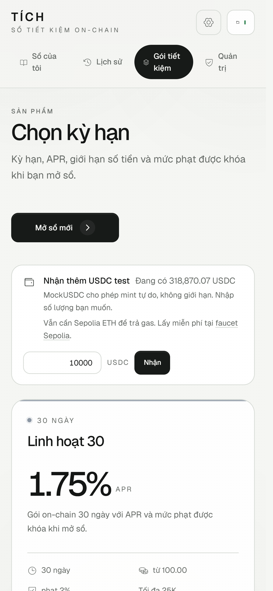
  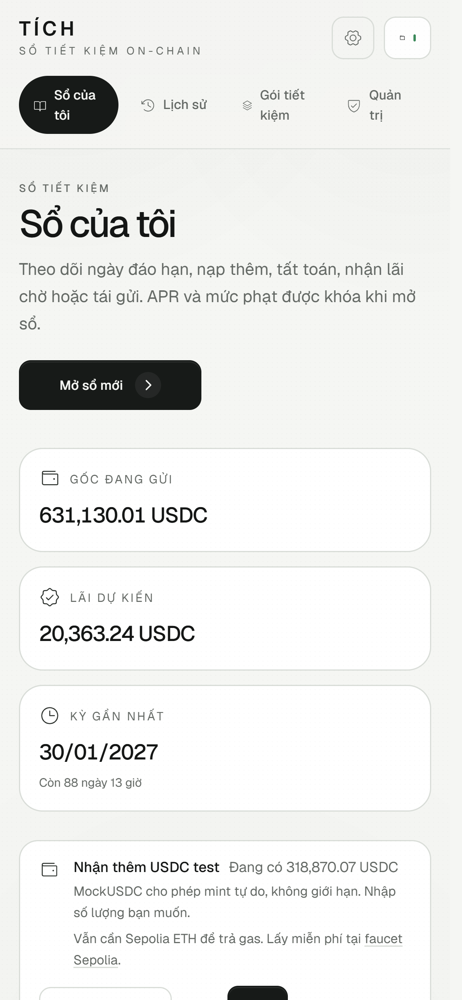
  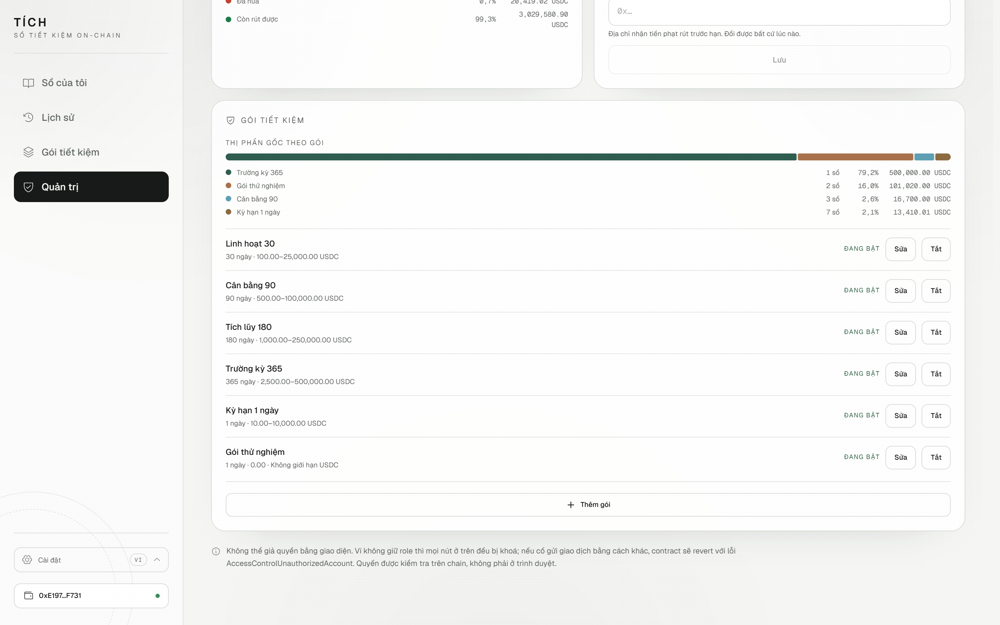
</p>

## Current status

| Area | Status |
| --- | --- |
| Source and tests | C1–C4 fully implemented. 104/104 contract tests pass, 49/49 frontend tests pass, 21/21 keeper tests pass, 100% contract line and statement coverage; `contracts:typecheck`, `build` and `lint` all pass. |
| Public Sepolia | Deployed on 2026-10-30 with 5 plans, `100,000 USDC` funded into the vault and 12 setup transactions (`2,929,946,052` wei of gas). All three contracts are verified on Etherscan; Sourcify reports `exact_match` for `VaultManager`/`SavingCore` and `match` for `MockUSDC`. |
| Sepolia E2E | Not re-run on the current address set. The 2026-10-29 `immediate` run belongs to the retired deployment; `npm run test:sepolia` must be run again to produce evidence for this build. |
| MetaMask walkthrough | Not re-run on the current address set; the 2026-10-29 record belongs to the retired deployment. |

## Personal parameters

Student ID **22665321**, last two digits: `A = 1` (units digit) and `B = 2` (tens digit).

| Parameter | Formula | Value | Explanation |
| --- | --- | --- | --- |
| Grace period | `(A mod 3) + 2` days | 3 days (259,200 seconds) | 3-day wait after maturity before auto-renew |
| Default APR | `200 + A × 25` bps | 225 bps = 2.25%/year | 100 bps equals 1% |
| Early-withdrawal penalty | `300 + B × 50` bps | 400 bps = 4.00% | Charged on the principal withdrawn |
| Default tenor | `B` even → 90 days | 90 days | Applied to the default plan |

The single source of truth is [contracts/config/personal.ts](contracts/config/personal.ts). Tests, deploy scripts and the manifest all read from it. The grace period is an `immutable` constructor parameter, so it cannot be changed after deployment; changing the student ID requires deploying a new set of contracts.

## Saving plan

Each plan is a product the admin creates, equivalent to "deposit for 90 days, earn 2.25% APR." The fields stored in the `SavingPlan` struct:

| Field | Meaning |
| --- | --- |
| `tenorDays` | Deposit duration (7, 30, 90, 180, 365 days…) |
| `aprBps` | Annual interest rate in basis points (225 = 2.25%/year) |
| `minDeposit` / `maxDeposit` | Optional min/max amount; `0` means no limit |
| `earlyWithdrawPenaltyBps` | Early-withdrawal penalty (400 = 4%), charged on the withdrawn principal |
| `enabled` | Admin can disable a plan to stop new deposits |

When a deposit is opened, `aprBps` and `earlyWithdrawPenaltyBps` are snapshotted into the NFT certificate. Later plan edits only affect new deposits; existing certificates are never changed.

## Admin functions

The admin manages the system through `VaultManager` and `SavingCore`; existing deposits cannot be modified.

| Function | Contract | Purpose |
| --- | --- | --- |
| `createPlan(tenorDays, aprBps, minDeposit, maxDeposit, penaltyBps)` | `SavingCore` | Create a new saving plan |
| `updatePlan(planId, newAprBps)` | `SavingCore` | Change the APR; only affects future deposits |
| `setPlanEnabled(planId, enabled)` | `SavingCore` | Enable/disable a plan; blocks new deposits when disabled |
| `fundVault(amount)` | `VaultManager` | Deposit tokens into the vault to cover interest |
| `withdrawVault(amount)` | `VaultManager` | Withdraw the unreserved part (`balance − reservedInterest`) |
| `setFeeReceiver(address)` | `VaultManager` | Set the address that receives early-withdrawal penalties |
| `pause()` / `unpause()` | `VaultManager` | Stop/resume all withdrawals, deposits and top-ups |

## Stack

| Layer | Technology | Version |
| --- | --- | --- |
| Runtime | Node.js | 22.22.2 (LTS) |
| Contracts | Solidity / Hardhat | 0.8.38 / 3.21.1 |
| Contracts | OpenZeppelin Contracts | 5.6.1 |
| Testing | Mocha / Chai / ethers | 12.0.3 / 6.3.0 / 6.17.0 |
| Frontend | React / Vite | 19.3.1 / 8.3.5 |
| Frontend | TypeScript / Tailwind CSS | 7.0.2 / 4.3.3 |
| Frontend | ethers / React Router | 6.17.0 / 7.18.5 |

The root `package.json` requires `engines.node >= 22.12`, the Vite 8 minimum. The test suite and the production build both ran on Node 22.22.2.

## Setup

```powershell
npm install
npm --prefix contracts install
npm --prefix keeper install
npm --prefix frontend install
```

## Frontend configuration

`configure:frontend` only accepts `testnet`; it reads [contracts/deployments/testnet.json](contracts/deployments/testnet.json) and writes `frontend/.env.local`:

```powershell
npm run configure:frontend -- testnet
```

Content generated for the current deployment:

```text
VITE_CHAIN_ID=11155111
VITE_DEPLOY_BLOCK=12026923
VITE_CORE_ADDRESS=0x10E9eDb55C0cD100F67DEc8b558649e66B263c79
VITE_VAULT_ADDRESS=0x1c5533537118320021b5795473cb2552d11Bf9B5
VITE_USDC_ADDRESS=0x460193B776F34D63413d358203516CA44d78ecfE
```

Only public addresses and the chain ID live in `VITE_*` variables; the private key is never placed here because every variable prefixed with `VITE_` is bundled. MetaMask signs transactions in the browser. If any of the three addresses is missing, [config.ts](frontend/src/contracts/config.ts) reports a configuration error instead of calling the contracts.

## Running the interface

```powershell
npm run dev
```

Open `http://127.0.0.1:5173/`, choose **Connect wallet**, select MetaMask (or another injected wallet enabled in the browser) and switch to **Sepolia** (chain ID `11155111`, RPC list at [chainlist.org/chain/11155111](https://chainlist.org/chain/11155111)). If the wallet does not have Sepolia yet, the interface offers to add it; if the wallet is on another network, a wrong-network dialog appears immediately in the center of the screen, clears stale data and offers **Switch to Sepolia**; no reload is needed.

Add the token to show the balance next to the wallet address: contract `0x460193B776F34D63413d358203516CA44d78ecfE`, symbol `USDC`, decimals `6`. MockUSDC is the token used for testing and its `mint` function is public, so a wallet with no funds can still receive tokens: call `mint` on Etherscan Write Contract with the amount in 6 decimals (1,000 USDC = `1000000000`). The wallet also needs Sepolia ETH to pay gas; faucet lists are in chainlist or at [sepoliafaucet.com](https://sepoliafaucet.com).

Main flow: on **Saving plans**, choose a tenor and open a deposit (the first time requires an `approve` for USDC, then `openDeposit`); on **My deposits**, view the NFT and settle, withdraw early in full or in part, add principal, claim deferred interest or renew; on **History**, review closed deposits with their realised PnL (read-only).

## Testing

```powershell
npm test
npm run test:frontend
npm run coverage
npm run contracts:typecheck
npm run build
npm run lint
```

Latest run (2026-10-30):

```text
104 passing (contract)
31 passing (frontend, Vitest)
MockUSDC       100.00% lines / 100.00% statements
VaultManager   100.00% lines / 100.00% statements
SavingCore     100.00% lines / 100.00% statements
Total          100.00% lines / 100.00% statements
```

The test suite covers the required flows and the edge cases most likely to break: missing allowance, APR snapshot after a plan edit, maturity/grace boundaries, double withdrawal, pause blocking every withdrawal path, NFT transfer changing the owner, penalties of 0/100%, interest rounding down to 0, top-up then maturity, partial then renew/auto-renew and the renew boundaries.

- **C1:** principal paid out and interest deferred when the vault is short of money; claim after funding the vault; claim follows the NFT; pause blocks claim; a `PrincipalWithdrawn` deposit cannot be reused for settlement.
- **C2:** only `SavingCore` holds `CORE_ROLE`; the admin cannot grant/revoke the role after it is locked; reserving more than the balance is blocked; `withdrawVault` is limited to `balance − reservedInterest`; when the vault loses its reserve, the admin cannot withdraw; release is correct on full or partial early withdrawal.
- **C3:** 11 partial early withdrawal cases.
- **C4:** mid-term top-up, multiple top-ups, proportional principal reduction and renewing a topped-up deposit.

### E2E on real Sepolia

`contracts/scripts/e2e` has three independent phases, stores progress in `contracts/deployments/testnet.e2e.json` (ignored) and only uses chain ID `11155111`:

```powershell
npm run test:sepolia            # immediate
npm run test:sepolia:status     # re-read state, check timestamps
npm run test:sepolia:mature     # after maturity
npm run test:sepolia:auto-renew # after maturity + grace
```

Result of the `immediate` phase on 2026-10-29 on the **previous deployment** (retired addresses): 19 real transactions with total gas `77,866,819,359` wei. The script checked:

- Opened 30-day plan D1 with `100 USDC`, topped up `50 USDC`, withdrew `40 USDC` early in part, and blocked a remainder below the minimum.
- Pausing the vault blocked opening, top-up and early withdrawal; unpausing restored normal operation.
- A second `setCoreOnce`, `grantRole(CORE_ROLE)` and `reserveInterest` from the deployer all revert.
- `withdrawVault` beyond the unreserved part is blocked; withdrawing and returning `1 USDC` leaves the vault balance unchanged.
- Fully early-withdrew D1; the `2.2 USDC` penalty (2% on the remaining `110 USDC`) went to the correct fee receiver.
- Opened T1–T6 on the 1-day plan; partial early withdrawal on T2; top-up on T3; transferred the T4 NFT to a second account.
- `reservedInterest` always equals the total interest of active deposits plus deferred interest, and the vault balance always covers the promised amounts.

T1 (certificate #2) was early-withdrawn on chain at `2026-10-29 08:40 UTC` (tx [`0x09a8cc...2c94`](https://sepolia.etherscan.io/tx/0x09a8ccc2e70cdd4dd3a5d91a1b0ec6b4dae0c3362f15560f7d9d3abbe44c2c94)), outside the `immediate` script; the `mature` phase will skip T1, settle T2–T4, renew T6 into the 90-day plan and let the new owner of T4 withdraw. The `auto-renew` phase will renew T5 after grace. `test:sepolia:status` prints the earliest timestamp of each phase.

### MetaMask interface walkthrough

On 2026-10-29 wallet `0xE19750FC95F44bE27E4ec44F2779d2C38ba6F731` operated the interface directly on Sepolia:

- Opened deposit #8, 1-day plan, `20 USDC`, APR `0.50%`: tx [`0xcc27ba...9b78`](https://sepolia.etherscan.io/tx/0xcc27ba3cc38e3c573b629181591e1b46e7cb76cd3d8e1bdfc9de22b1cd799b78).
- Topped up `10 USDC`, new principal `30 USDC`: tx [`0xddf627...9378`](https://sepolia.etherscan.io/tx/0xddf627314360b3192a4af405310fd417653a1953b276d41ae147fa27254a9378).
- Partial early withdrawal of `10 USDC`, penalty `0.10 USDC`, `20 USDC` remaining: tx [`0x3d4e93...e4a`](https://sepolia.etherscan.io/tx/0x3d4e93ed7453722f4247bc5e55e733cb1c221ad4b7b30b0bd2569354fed86e4a).
- Full early withdrawal of `20 USDC`, penalty `0.20 USDC`, `19.80 USDC` received: tx [`0x37ec17...4a28`](https://sepolia.etherscan.io/tx/0x37ec175dd807d21e0e197085cef897128ce76895cf11af28ceae1908ae6a4a28).
- Switched VI↔EN, which survives a reload; checked the empty state, the loading state and the below-minimum amount error in both languages.

### Auto-renew keeper

Section 3.5 of the brief requires an off-chain bot that calls `autoRenewDeposit`. The keeper is a standalone package at [keeper/](keeper/README.md): it imports neither Hardhat nor `contracts/`, so it needs only Node and an RPC endpoint and can be copied to a VPS or PaaS as-is. Each pass reads every deposit in **a single `eth_call`** (Multicall3) and selects only `Active` deposits where `block.timestamp >= maturityAt + gracePeriod`. `autoRenewDeposit` is permissionless, so the bot wallet needs no role, no USDC and no approval — only ETH for gas.

```powershell
npm --prefix keeper install
# create keeper/.env from .env.example, or reuse RPC_URL/KEEPER_PRIVATE_KEY from contracts/.env
npm run keeper:start                              # single pass
KEEPER_DRY_RUN=1 npm run keeper:start             # report only, send nothing
KEEPER_MODE=watch KEEPER_INTERVAL_SECONDS=300 npm run keeper:start
```

| Variable | Default | Meaning |
| --- | --- | --- |
| `RPC_URL` | — | JSON-RPC endpoint, required |
| `KEEPER_PRIVATE_KEY` | — | Bot wallet key, required |
| `CORE_ADDRESS` / `VAULT_ADDRESS` / `USDC_ADDRESS` | — | Contract addresses; when empty `MANIFEST_PATH` is read |
| `KEEPER_MODE` | `watch` | `watch` keeps the bot running; `once` runs a single pass and exits |
| `KEEPER_DRY_RUN` | `0` | `1` reports only and sends no transactions |
| `KEEPER_INTERVAL_SECONDS` | `300` | Idle time between passes in `watch` mode |
| `KEEPER_MAX_RENEWALS_PER_RUN` | `10` | Caps transactions per pass so gas cannot run away |
| `KEEPER_LOG_WAITING_LIMIT` | `0` | Waiting deposits printed per pass; `0` prints all |
| `KEEPER_MAX_COST_ETH` | `0.005` | Cumulative gas ceiling for one pass |
| `KEEPER_MIN_BALANCE_RESERVE_ETH` | `0.005` | Minimum ETH balance the bot keeps |
| `MAX_BASE_FEE_GWEI` / `MAX_FEE_GWEI` | `1` / `2` | Refuse to send above this base fee; `maxFeePerGas` ceiling |

Three layers of protection: `staticCall` simulates before sending, so a revert (grace not elapsed, system paused, vault short of interest) is caught without spending gas; every transaction goes through a gas guard that checks for a pending nonce, the fee ceilings, the balance reserve and the receipt; a failure on one deposit does not abort the pass. The decision logic — the `maturityAt + gracePeriod` boundary, terminal statuses and config parsing — is covered by 20 tests in the package (`npm run keeper:test`).

## Architecture

| Contract | Holds | Main functions |
| --- | --- | --- |
| `MockUSDC` | no money | ERC-20 with 6 decimals; **no `Ownable`, no roles, no cap** — `mint` is open to any address so anyone can faucet |
| `VaultManager` | the bank's interest money | vault deposits/withdrawals, fee receiver, pause, reserve/release/pay interest |
| `SavingCore` | depositors' principal | plans, NFT certificates, snapshots, settlement, claim, top-up, early withdrawal, renewal |
| `IVaultManager` | — | interface defining data types for calls from core to vault |

Principal and interest are kept separate so settling one deposit does not draw on other depositors' principal. `SavingCore` only pays back principal equal to what it received when the deposit was opened; all interest flows through `VaultManager`. With C1, if the vault is short of money at maturity, principal is still paid immediately and interest is recorded as debt in `pendingInterest`; the current NFT owner calls `claimInterest` once the vault has funds. Renewal remains atomic: if the vault lacks interest, the whole renewal transaction reverts.

Each deposit stores `principal`, `aprBpsAtOpen`, `penaltyBpsAtOpen`, `tenorDays`, `openedAt`, `maturityAt`, `status` and `principalSeconds`; later plan edits only affect new deposits.

```text
open:        principalSeconds = principal × tenorDays × 1 day
top-up:      principalSeconds += amount × (maturityAt − block.timestamp)
interest     = principalSeconds × aprBpsAtOpen / (365 × 86_400 × 10_000)
penalty      = amount × penaltyBpsAtOpen / 10_000
```

Five states: `Active`, `Withdrawn`, `ManualRenewed`, `AutoRenewed`, `PrincipalWithdrawn`. Three ways to end a deposit are settlement, full early withdrawal and manual renewal; all three check `status == Active` and `ownerOf(depositId) == msg.sender`. `topUpDeposit` only applies to an `Active` deposit before maturity. `claimInterest` only applies to a `PrincipalWithdrawn` deposit.

### Events

The five required events from the brief, plus supporting events for C1–C4:

| Event | Contract | Meaning |
| --- | --- | --- |
| `PlanCreated(planId, tenorDays, aprBps)` | `SavingCore` | New plan created |
| `PlanUpdated(planId, newAprBps)` | `SavingCore` | APR changed; only affects future deposits |
| `PlanStatusChanged(planId, enabled)` | `SavingCore` | Plan enabled/disabled |
| `DepositOpened(depositId, owner, planId, principal, maturityAt, aprBpsAtOpen)` | `SavingCore` | Deposit opened, NFT minted |
| `Withdrawn(depositId, owner, principal, interest, isEarly)` | `SavingCore` | Settlement or full early withdrawal |
| `Renewed(oldDepositId, newDepositId, newPrincipal, newPlanId)` | `SavingCore` | Manual renewal or auto-renew |
| `PartialEarlyWithdrawn(depositId, owner, amount, penalty, remainingPrincipal)` | `SavingCore` | Partial early withdrawal (C3) |
| `DepositToppedUp(depositId, owner, amount, newPrincipal, interestAdded)` | `SavingCore` | Principal topped up (C4) |
| `InterestDeferred(depositId, owner, amount)` | `SavingCore` | Interest recorded as debt when vault is short (C1) |
| `InterestClaimed(depositId, owner, amount)` | `SavingCore` | Deferred interest claimed (C1) |
| `VaultFunded(funder, amount)` | `VaultManager` | Vault funded |
| `VaultWithdrawn(recipient, amount)` | `VaultManager` | Unreserved part withdrawn |
| `FeeReceiverUpdated(previousReceiver, newReceiver)` | `VaultManager` | Fee receiver changed |
| `InterestReserved(amount, totalReserved)` | `VaultManager` | Interest reserved on open/top-up (C2) |
| `InterestReleased(amount, totalReserved)` | `VaultManager` | Reservation released on early withdrawal (C2) |
| `InterestPaid(recipient, amount)` | `VaultManager` | Interest paid to depositor |
| `CoreRoleLocked(core)` | `VaultManager` | `CORE_ROLE` locked after `setCoreOnce` (C2) |

## Design Answers

The seven questions below correspond to section 8.2 of the brief. Each answer covers the rule, the decision in the code and the trade-off.

### 1. If Alice transfers the NFT to Bob, who can withdraw?

Bob. Because the certificate is an NFT, the right to withdraw belongs to whoever currently owns the NFT. `_requireActiveOwner` checks `ownerOf(depositId) == msg.sender` in `withdrawAtMaturity`, `earlyWithdraw`, `earlyWithdrawPartial` and `renewDeposit`; `claimInterest` checks the NFT owner separately; `topUpDeposit` uses the shared `_requireActiveOwner`. Auto-renew mints a new deposit for the current NFT owner. If Alice calls after transferring, the transaction reverts with `Core: not certificate owner`.

Trade-off: losing the wallet or transferring to the wrong address also loses the withdrawal right, and the bank cannot intervene. On the other hand, someone who needs cash urgently can sell the deposit on the secondary market instead of taking the 4% penalty.

### 2. What happens if the vault is short of money at maturity?

Principal is still paid immediately, while interest is deferred and received later (C1). `withdrawAtMaturity` wraps the `vault.payInterest` call in `try/catch`; if the vault reverts, the deposit moves to `PrincipalWithdrawn`, the interest is recorded in `pendingInterest[depositId]`, an `InterestDeferred` event is emitted and the principal is still paid in full. The current NFT owner calls `claimInterest` once the vault is funded. The function clears the debt before calling the vault; if the vault is still short, the whole transaction reverts and the user can try again. Claims are also blocked when the system is paused.

Trade-off: deferred interest is not pushed to the wallet, so the user has to come back to claim; the frontend shows the `Interest pending` state. Manual renewal and auto-renew still follow an all-or-nothing rule because they need the interest to form the new principal.

### 3. If the auto-renew bot goes down for a month, who loses?

Nobody loses money. The bot only calls the renewal function on the user's behalf: the old deposit keeps its `Active` status, is not deleted and does not lose interest already recorded. The user can still withdraw with `withdrawAtMaturity` or renew with `renewDeposit` at any time after maturity. Because `autoRenewDeposit` lets any address call after maturity plus grace, the user's own wallet or a third party can stand in for the bot.

The only impact is that the money stays in the deposit for another month instead of being renewed. The repo ships a keeper at [keeper/](keeper/README.md) to stand in for the bot; because `autoRenewDeposit` is permissionless, a second keeper or the user's own wallet can take over when the primary bot is down.

### 4. How is the remainder handled when splitting interest?

For interest, the remainder stays in the vault; for penalties, the remainder is returned with the principal to the withdrawer. Both use `Math.mulDiv` in `_interestFor` and `_penaltyFor`: multiply before dividing and always round down, so the amount paid only gets smaller and is never negative. An interest amount of 2.777... USDC pays 2.77 USDC; the fraction below one 6-decimal unit stays in the vault.

Interest rounding down to 0 does not cause a stuck deposit either: `withdrawAtMaturity` has `if (interest > 0)`, so it skips the vault and still pays the principal in full. A test opens a 1-unit deposit at 1 bps APR with a 1-day tenor and still withdraws the principal normally. There is no separate accounting ledger, so the remainder cannot be withdrawn twice.

### 5. Is a transaction at the exact maturity moment an early withdrawal or an on-time one?

It is an on-time withdrawal. Before `maturityAt` is early; from that moment on it is on time, with no transition window. `withdrawAtMaturity` and `renewDeposit` use `>=`; `earlyWithdraw` and `earlyWithdrawPartial` use `<`. Using `>=` ensures that someone settling exactly at maturity is not penalized by mistake.

Auto-renew requires `block.timestamp >= maturityAt + gracePeriod`, so renewal is possible exactly when grace ends. Users can still renew manually in the last second of grace if the bot has not run yet, because `renewDeposit` only requires `>= maturityAt` and does not depend on grace.

### 6. What happens if the admin disables a plan while deposits are still active?

Active deposits are unaffected. When a deposit is opened, the contract has already snapshotted the APR, tenor and penalty into that deposit, so editing or disabling the plan later only affects newly opened deposits. `setPlanEnabled` only changes the `enabled` flag. Holders of old deposits can still settle, withdraw early in full or in part at the old rates, or renew into another enabled plan.

Two exceptions: manual renewal into a disabled plan is blocked because `renewDeposit` requires `newPlan.enabled`; auto-renew still uses the original plan because that is the commitment made to the original depositor. Top-ups remain allowed on a disabled plan: `topUpDeposit` does not open a new deposit and every term is already snapshotted in the certificate, so disabling a plan only stops new money.

### 7. A real attack scenario and how it is prevented

Scenario: withdrawing money twice, including a nested call while the first transaction is still in flight (reentrancy). Four layers of protection:

1. Eight functions that move money (`openDeposit`, `withdrawAtMaturity`, `claimInterest`, `topUpDeposit`, `earlyWithdraw`, `earlyWithdrawPartial`, `renewDeposit`, `autoRenewDeposit`) all carry `nonReentrant`.
2. State is updated before money is transferred, so a second withdrawal stops at `_requireActiveOwner` with `Core: deposit inactive`. `claimInterest` clears `pendingInterest` before calling the vault; `earlyWithdrawPartial` reduces `principal` and `principalSeconds` before transferring money.
3. `VaultManager` only accepts calls from `SavingCore`; `asset` and `vault` are `immutable`, so they cannot be replaced by a fake contract after deployment.
4. C2 maintains `reservedInterest`; `withdrawVault` only allows withdrawing the unreserved part and `payInterest` rejects unreserved amounts. `setCoreOnce` locks `CORE_ROLE` and `reserveInterest` requires the reserve to be backed by real money.

Remaining limitation: the reservation is only an accounting ledger inside the same vault, not a separate escrow; the admin remains a trusted role for plans, pause, fee receiver and the unreserved part. Reducing trust requires a multisig/timelock.

## Creative Challenge C1 — Pay principal now, defer interest

**Problem.** The brief requires `withdrawAtMaturity` to revert if the vault lacks interest, which locks the depositor's principal behind the bank's interest debt even though the principal is fully available in `SavingCore`.

**Approach.** `withdrawAtMaturity` wraps `vault.payInterest` in `try/catch`. If the vault can pay, the deposit becomes `Withdrawn`. If not, the deposit becomes `PrincipalWithdrawn`, the interest goes into `pendingInterest` and an `InterestDeferred` event is emitted; the principal is still transferred immediately. `claimInterest` lets the current NFT owner receive exactly the recorded debt, clears the debt before calling the vault and is blocked when paused. The pending amount stays inside `reservedInterest`, so C2 does not let the admin withdraw it.

**Trade-off.** The user has to come back to claim; a deposit whose principal has been paid cannot be used for renewal or further withdrawals; renew/auto-renew still revert when the vault lacks interest.

**Tests.** Five cases: paying principal and recording the debt, claiming after funding the vault, the claim following the NFT, pause blocking claims, and a `PrincipalWithdrawn` deposit not being reusable for settlement. The vault is fully funded, so C1 is exercised in the unit suite, where a shortfall can be created without breaking C2.

## Creative Challenge C2 — Lock the promised interest

**Problem.** If the admin can withdraw freely, the admin can withdraw exactly the interest owed to active deposits. Depositors still see the expected interest in the interface but only find out the vault is empty at maturity.

**Approach.**

- `VaultManager` stores `reservedInterest`, accumulating every promised interest amount.
- `SavingCore` calls `reserveInterest` when opening a deposit and when topping up; calls `releaseInterest` on full early withdrawal or a partial principal reduction; `payInterest` subtracts from the reservation when paying interest.
- `withdrawVault` only lets the admin withdraw `balance − reservedInterest`; if `balance < reservedInterest` it reverts with `Vault: undercollateralized`.
- `setCoreOnce(address)` grants `CORE_ROLE` to `SavingCore` exactly once, then sets the admin of `CORE_ROLE` to `CORE_ROLE` itself. After that, `DEFAULT_ADMIN_ROLE` can no longer grant/revoke `CORE_ROLE`.
- `reserveInterest` rejects the call if `reservedInterest + amount > vault balance`, so the invariant `balance >= reservedInterest` holds from the moment of reservation.

**Trade-off.**

- The vault must be funded before opening a deposit or topping up; otherwise the transaction reverts instead of recording interest with no money behind it.
- This is still an accounting ledger, not a separate escrow. If tokens are lost or drained from the vault, the invariant is violated; `withdrawVault` is then blocked and C1 still protects the principal.
- The admin remains a trusted role for plans, pause, fee receiver and the unreserved part.

**Tests.** The cases in `VaultManager.ts` check role locking, one-time setup, reserving beyond the balance, the admin withdrawal cap, the vault losing its reserve and release on early withdrawal. The open, top-up and settlement cases in `SavingCore.ts` also check that `reservedInterest` increases/decreases accordingly.

**Sepolia status.** The `0x10E9eDb5…3c79` build includes full C2: `setCoreOnce`, locked `CORE_ROLE`, guaranteed reserves and the withdrawal cap. The `immediate` phase verified it on the real chain.

## Creative Challenge C3 — Partial early withdrawal

**Problem.** `earlyWithdraw` only supports full withdrawal: even when only a small part is needed, the depositor still has to close the whole deposit and pay a 4% penalty on the entire principal.

**Approach.** `earlyWithdrawPartial` only runs before `maturityAt`, when the deposit is `Active` and the caller is the current NFT owner. The penalty is charged on exactly the withdrawn amount; the remaining `principal - amount` must be `>= minDeposit` of the plan, otherwise it reverts with `Core: remaining below minimum`. APR, penalty, tenor and `maturityAt` stay the same; the NFT stays the same and only `principal` is reduced. The withdrawn part earns no interest; maturity interest is calculated on the remaining part. Event: `PartialEarlyWithdrawn(depositId, owner, amount, penalty, remainingPrincipal)`.

Example: a 1,000 USDC deposit in a plan with a 500 USDC minimum; early-withdrawing 200 USDC incurs an 8 USDC penalty, pays 192 USDC, and the remaining 800 USDC continues to the original maturity date. For a 500 USDC deposit, withdrawing 200 USDC would leave 300 USDC, below the 500 USDC minimum, so the transaction reverts; the only option is a full `earlyWithdraw`.

**Trade-off.** The deposit is not split into separate parts: one NFT and one `depositId`, with history read from events. Withdrawals that would leave less than the minimum are not possible. Future interest decreases with the remaining principal.

**Tests.** 11 cases: penalty on the withdrawn part, keeping the snapshot, remaining minimum, owner/NFT, pause, 0/100% penalty, maturity interest on the remainder and full withdrawal after a partial one. The frontend is integrated: full withdrawal is the default, and a smaller amount calls `earlyWithdrawPartial`.

## Creative Challenge C4 — Top-up into a running deposit

**Problem.** An opened deposit does not accept more money: adding funds means opening a new deposit, losing the original maturity date and taking the new APR.

**Approach.** `Deposit` adds `principalSeconds`. When a deposit is opened, the value equals `principal × tenorDays × 1 day`; interest is calculated as `principalSeconds × aprBpsAtOpen / (365 days × 10,000)`. `topUpDeposit` only runs when the deposit is `Active`, before maturity, with the correct NFT owner and the system not paused. The contract accepts additional principal, adds `amount × (maturityAt − block.timestamp)` to `principalSeconds`, then reserves exactly the extra interest. Tenor, APR, penalty and `maturityAt` stay the same; no new NFT is minted and the `depositId` does not change. `principalSeconds` is reduced proportionally on partial early withdrawal, so the withdrawn part stops earning interest.

Example: a 1,000 USDC deposit with a 90-day tenor, topped up with 500 USDC after 30 days. The new 500 USDC only earns interest for the remaining 60 days. The original plan's `maxDeposit` limit still applies to the total principal after the top-up.

**Trade-off.** Not split into separate parts: top-up history is read from the `DepositToppedUp` event and all principal shares one APR snapshot. Top-ups are not possible after maturity. If the deposit is early-withdrawn afterwards, the penalty is charged on the entire remaining principal at the original snapshot.

**Boundary.** `maxDeposit` is checked when a deposit is opened and on top-up, but not again in `renewDeposit` or `autoRenewDeposit`. When `renewDeposit` targets a different plan, that plan's `minDeposit` is not re-checked either: the new principal is the old principal plus interest, so a plan with a higher minimum can end up with a deposit below its minimum. `autoRenewDeposit` reuses the original plan, so the minimum always holds, but the new principal can exceed `maxDeposit` slightly. This build accepts that boundary because blocking renewal would lock a matured certificate; `maxDeposit` is treated as a limit on new money. To close it, add min/max checks inside `renewDeposit` and a matching revert test.

**Tests.** Four cases: mid-term top-up with interest based on principal-seconds and the correct reserve increase, rejection of wrong owner/zero amount/above the maximum/pause/after maturity, proportional reduction after a partial early withdrawal, and renewing a topped-up deposit.

## Deploying to Sepolia

The `testnet` network is fixed at chain ID `11155111`; the repo has no local, fork or parallel deploy script. Hardhat's in-process network (`31337`) is only used for unit tests. Deployment needs `TESTNET_RPC_URL` and `DEPLOYER_PRIVATE_KEY`; source verification additionally needs `ETHERSCAN_API_KEY`. These can be placed in `contracts/.env` (ignored) or passed for the PowerShell session only:

```powershell
$env:TESTNET_RPC_URL='https://ethereum-sepolia-rpc.publicnode.com'
$env:DEPLOYER_PRIVATE_KEY='0x...'
$env:FEE_RECEIVER_ADDRESS='0x...'                     # optional, defaults to the deployer
$env:EXPLORER_BASE_URL='https://sepolia.etherscan.io'  # optional, only written to the manifest
$env:ETHERSCAN_API_KEY='...'                           # only needed for source verification

npm run deploy:testnet:dry   # estimate gas, no transactions sent
npm run deploy:testnet
npm run verify:testnet
npm run configure:frontend -- testnet
```

`deploy:testnet:dry` only reads the RPC and prints the worst-case cost. `verify:testnet` compares the manifest with the real chain: chain ID, addresses derived from receipts, nonce continuity, block range, gas, bytecode presence, token–vault–core wiring, `vault.core()`, the admin of `CORE_ROLE` being locked, fee receiver, grace period, the tenor/limits/penalty of the five manifest plans, the vault funding and `reservedInterest <= vault balance`. Once e2e has opened deposits, add `ALLOW_POST_E2E=1` to skip the fresh-deploy snapshot checks. That flag also skips APR, enabled state and plan count, because `updatePlan`, `setPlanEnabled` and `createPlan` are allowed to change them after deployment. The script needs an RPC that still serves old receipts (publicnode has pruned them, tenderly has not).

Source verification runs inside `contracts/`:

```powershell
npx hardhat verify --network testnet <MockUSDC>
npx hardhat verify --network testnet <VaultManager> <MockUSDC> <admin> <feeReceiver>
npx hardhat verify --network testnet <SavingCore> <MockUSDC> <VaultManager> 259200
```

### Current deployment

| Contract | Sepolia address |
| --- | --- |
| `MockUSDC` | [`0x460193B776F34D63413d358203516CA44d78ecfE`](https://sepolia.etherscan.io/address/0x460193B776F34D63413d358203516CA44d78ecfE#code) |
| `VaultManager` | [`0x1c5533537118320021b5795473cb2552d11Bf9B5`](https://sepolia.etherscan.io/address/0x1c5533537118320021b5795473cb2552d11Bf9B5#code) |
| `SavingCore` | [`0x10E9eDb55C0cD100F67DEc8b558649e66B263c79`](https://sepolia.etherscan.io/address/0x10E9eDb55C0cD100F67DEc8b558649e66B263c79#code) |

Deployer, also the fee receiver: [`0xE19750FC95F44bE27E4ec44F2779d2C38ba6F731`](https://sepolia.etherscan.io/address/0xE19750FC95F44bE27E4ec44F2779d2C38ba6F731). Contracts deployed at block `12026923`; 12 setup transactions ended at block `12026936`, total gas `2,929,946,052` wei (≈ `0.0000033` ETH). Full manifest at [contracts/deployments/testnet.json](contracts/deployments/testnet.json).

Five on-chain plans:

| Plan | Tenor | APR | Minimum | Maximum | Early penalty |
| --- | --- | --- | --- | --- | --- |
| 1 | 30 days | 1.75% | 100 USDC | 25,000 USDC | 2.00% |
| 2 | 90 days | 2.25% | 500 USDC | 100,000 USDC | 4.00% |
| 3 | 180 days | 3.00% | 1,000 USDC | 250,000 USDC | 4.50% |
| 4 | 365 days | 4.00% | 2,500 USDC | 500,000 USDC | 5.00% |
| 5 | 1 day | 0.50% | 10 USDC | 10,000 USDC | 1.00% |

Deploy and setup transactions (blocks `12026923`–`12026936`, total gas `2,929,946,052` wei ≈ `0.0000029` ETH):

- Deploy `MockUSDC`: [`0x4ee113…a1d17`](https://sepolia.etherscan.io/tx/0x4ee11388af6d3f7ad5933a766e7d1d643ff6af68db590cdcb50d57f631fa1d17)
- Deploy `VaultManager`: [`0x799f54…9eb29`](https://sepolia.etherscan.io/tx/0x799f5499ec0ce87e7bbd4a9fd4f9a4820a2b4fd66a3e806ac7fad9a06f99eb29)
- Deploy `SavingCore`: [`0x95a234…aaa83`](https://sepolia.etherscan.io/tx/0x95a23485b6852266b6f7f2e94dac4b38a17008a40b34f79d9be732a56adaaa83)
- `setCoreOnce`: [`0x2be2b9…e4012`](https://sepolia.etherscan.io/tx/0x2be2b9c4f10dd1e71141a50cc13007a1c4b48fc3f807ce0cb75ceb67f82e4012)
- Mint `150,000 USDC` + approve + fund the vault with `100,000 USDC`: [`0x5653c4…3a533`](https://sepolia.etherscan.io/tx/0x5653c4068d55a93da923d342d86c4314d47595842c97e7a43c919f2cc593a533), [`0x4e4f71…3c483`](https://sepolia.etherscan.io/tx/0x4e4f7185424ba27132f5a9f2d39e6030e983980ed5ffa35c511f96dabb23c483), [`0x813d3d…d395a`](https://sepolia.etherscan.io/tx/0x813d3db1861e548c2436bcc19c64343a47585c9a98473c17dc5b3745cd7d395a)
- Create 5 plans: [`0x2ccc21…2796f`](https://sepolia.etherscan.io/tx/0x2ccc213970458535d04b1db4f39686bd3c337937f3260313a71c60b11f02796f), [`0x854539…99b45`](https://sepolia.etherscan.io/tx/0x8545390fb6e32281267c5ae1991f6f39895d5e1d9d6f0e6813f4faa293b99b45), [`0xa3e862…5764c`](https://sepolia.etherscan.io/tx/0xa3e8620ed2ce165924d653f8d39df8c70a888926e6c1504095f21e37d305764c), [`0x1ae613…4eff0`](https://sepolia.etherscan.io/tx/0x1ae6132ebafcc6b2e677821c90714f7f2757c335cf9248b77ab0613ce954eff0), [`0x17fe35…3eb98`](https://sepolia.etherscan.io/tx/0x17fe35544f844c2db017639a50c76ce7cdbc13f8115fb09fae3277d2b2a3eb98)

The `immediate` e2e phase has **not been re-run** on this address set. The 2026-10-29 run belongs to the retired deployment and its state is archived outside the repo; `mature` and `auto-renew` still wait for real chain time.

## Deliverables

| Component | Description |
| --- | --- |
| Smart Contracts | `MockUSDC.sol` (ERC-20, 6 decimals, public mint), `VaultManager.sol` (vault, fee receiver, pause, reserve/release/pay), `SavingCore.sol` (plans, NFT, snapshots, settlement, claim, top-up, early withdrawal, renewal). Interface `IVaultManager` defines data types for core-to-vault calls. |
| Tests | 89 Hardhat tests (contract) + 31 Vitest tests (frontend) + 20 keeper tests, 100% contract line and statement coverage. Covers all required flows and edge cases: missing allowance, APR snapshot after plan edit, maturity/grace boundaries, double withdrawal, pause blocking every path, NFT transfer changing owner, 0/100% penalty, interest rounding to 0. |
| Frontend | React + TypeScript + Tailwind, injected-wallet connection via EIP-6963 (MetaMask default). Four required flows: view plans, open deposit, view deposits, withdraw/renew — plus C1 (claim deferred interest), C3 (partial early withdrawal), C4 (top-up). Bilingual VI–EN, with connect/loading/empty/error states. |
| Auto-renew keeper | Standalone `keeper/` package scanning deposits past grace and calling `autoRenewDeposit`; single pass or `watch`, with dry-run, a gas ceiling and a `staticCall` simulation before sending. Copy the folder to a VPS and it runs, no Hardhat needed. |
| Design Answers | Seven answers in the README, corresponding to section 8.2 of the brief, covering the rule, the code decision and the trade-off. |
| Personal Variant | Student ID `22665321` → `A=1`, `B=2`, grace 3 days, APR 225 bps, penalty 400 bps, tenor 90 days. Single source: [contracts/config/personal.ts](contracts/config/personal.ts). |
| Creative Challenges | C1 (pay principal now, defer interest), C2 (lock promised interest), C3 (partial early withdrawal), C4 (top-up). Each challenge has its own tests and a README note covering problem/approach/trade-off/tests. |
| Demo video | 3–5 minute frontend walkthrough, as required by section 11 of the brief. |

## Common commands

| Command | Purpose |
| --- | --- |
| `npm run dev` | run Vite on port 5173 |
| `npm run build` | type-check and build the frontend production bundle |
| `npm run lint` | run oxlint |
| `npm test` | run the 89 Hardhat tests |
| `npm run coverage` | run tests with a coverage report |
| `npm run contracts:typecheck` | type-check the contract TypeScript |
| `npm run contracts:compile` | compile contracts with Hardhat |
| `npm run contracts:export-abis` | compile and regenerate `frontend/src/contracts/abis.ts` |
| `npm run deploy:testnet:dry` | estimate Sepolia deploy gas without sending transactions |
| `npm run deploy:testnet` | deploy to Sepolia |
| `npm run verify:testnet` | verify the Sepolia deployment |
| `npm run configure:frontend -- testnet` | write `frontend/.env.local` from the manifest |
| `npm run test:sepolia` | run the `immediate` phase on real Sepolia |
| `npm run test:sepolia:status` | read phase state and timestamps |
| `npm run test:sepolia:mature` | run the post-maturity settlement/renewal phase |
| `npm run test:sepolia:auto-renew` | run the auto-renew phase after grace |
| `npm run keeper:start` | keeper bot renewing deposits past grace (`KEEPER_MODE`, `KEEPER_DRY_RUN`) |
| `npm run keeper:test` | run the 20 keeper package tests |

All deploy, verify, e2e and keeper commands are locked to chain ID `11155111`; the repo has no local, fork or parallel deploy script. The in-process `31337` network is only for unit tests.
