# TÍCH — Sổ tiết kiệm kỳ hạn on-chain

<p><a href="README.md"></a>&nbsp;<a href="README.en.md"></a></p>

TÍCH là hệ thống sổ tiết kiệm có kỳ hạn on-chain: người gửi nạp MockUSDC, nhận chứng chỉ NFT (ERC-721) và hưởng lãi đơn theo APR cố định tại thời điểm mở sổ. Người gửi có thể nạp thêm gốc (C4), tất toán đúng hạn, rút trước hạn một phần (C3) hoặc toàn bộ, nhận lãi chờ khi vault thiếu tiền (C1) và tái gửi sang kỳ hạn mới.

Giao diện React + TypeScript kết nối ví injected qua EIP-6963 (MetaMask mặc định; Rabby, Coinbase Wallet, Brave và các ví injected khác cũng dùng được), đọc/ghi trực tiếp lên ba contract trên Sepolia. Sau khi kết nối, số dư, gói và sổ đều được đọc từ chain; trong thời gian chờ RPC hiển thị trạng thái đang tải. Mọi ví đã kết nối đều thấy ô **Nhận USDC test** trên trang Plans và Deposits và tự nhập số lượng muốn nhận: `MockUSDC.mint` mở công khai, không giới hạn, nên ai cũng tự nạp được — chỉ cần Sepolia ETH trả gas.

> **Lưu ý thiết kế — MockUSDC cố ý không có ownership.** Contract không kế thừa `Ownable`, không có `owner`, không role và không giới hạn cung: `mint` mở cho bất kỳ địa chỉ nào, ai cũng gọi được bao nhiêu tùy thích. Đây là chủ ý để người lạ vào bản demo tự faucet mà không cần admin đứng ra cấp token. Đánh đổi là không có cách nào thu hồi hay chặn phát hành, nên token này **chỉ dùng cho testnet**. Một token thật phải có access control, giới hạn cung và đường phát hành riêng.

## Screen

<p align="center">
  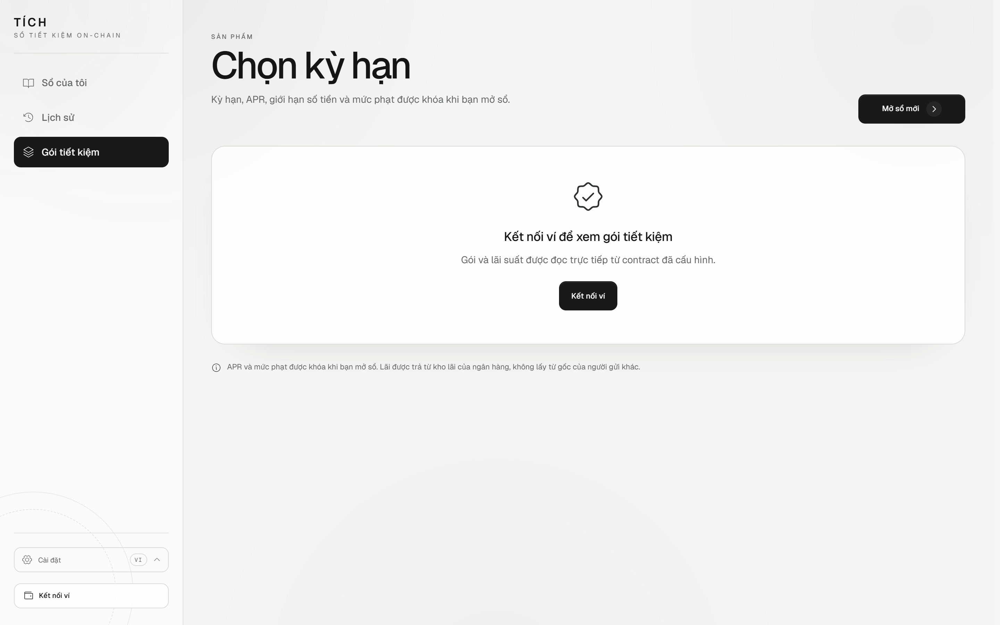
  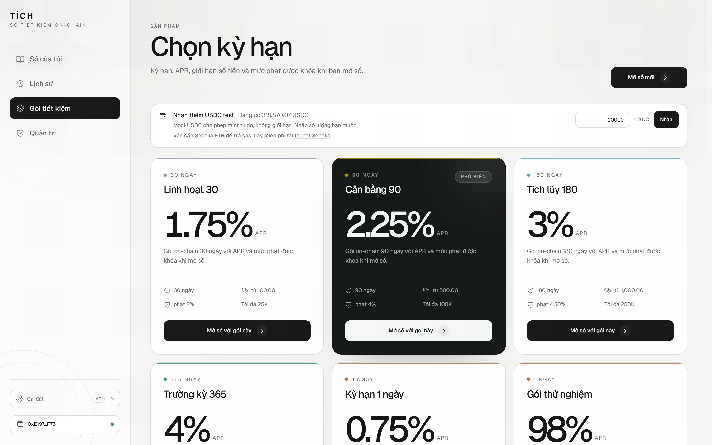
  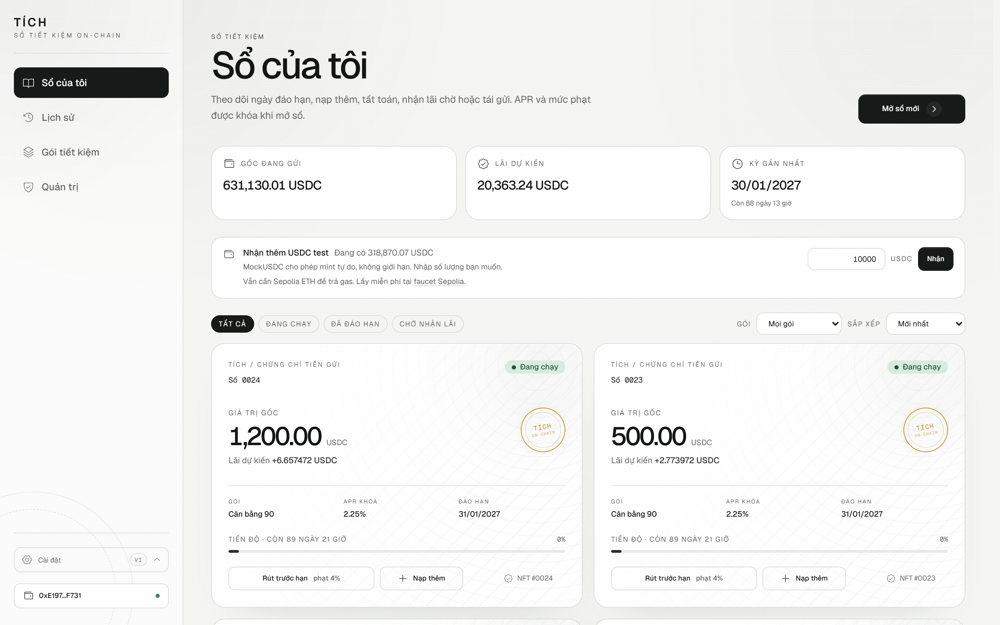
</p>

<p align="center">
  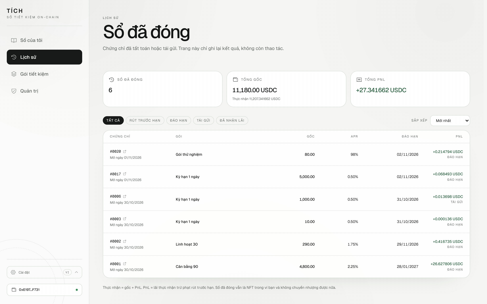
  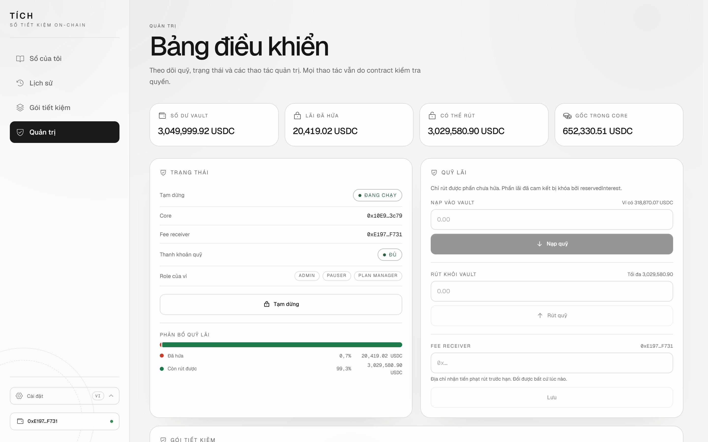
  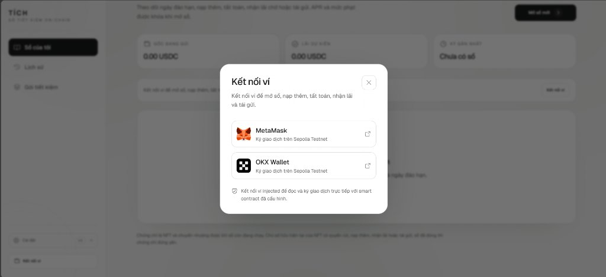
</p>

<p align="center">
  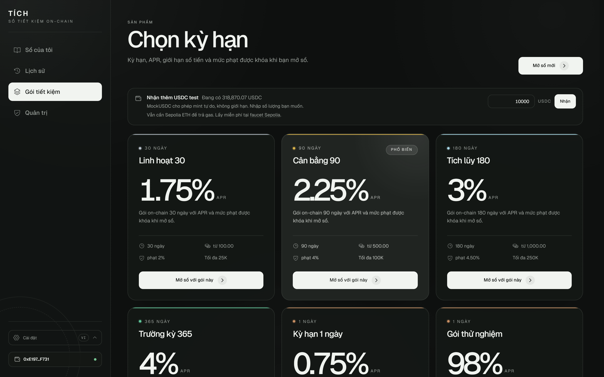
  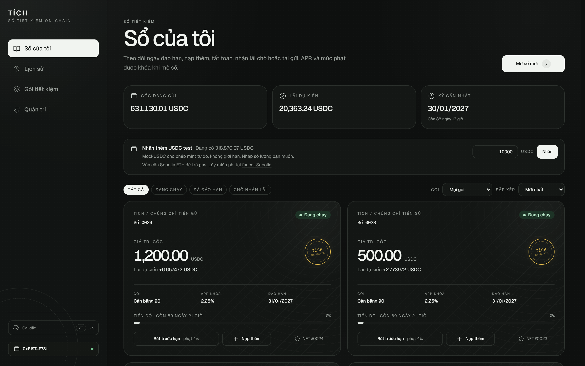
  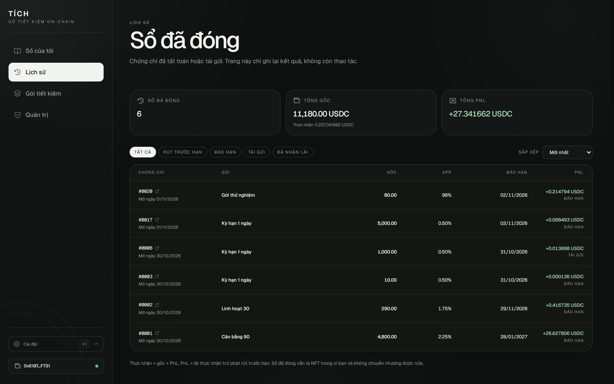
</p>

<p align="center">
  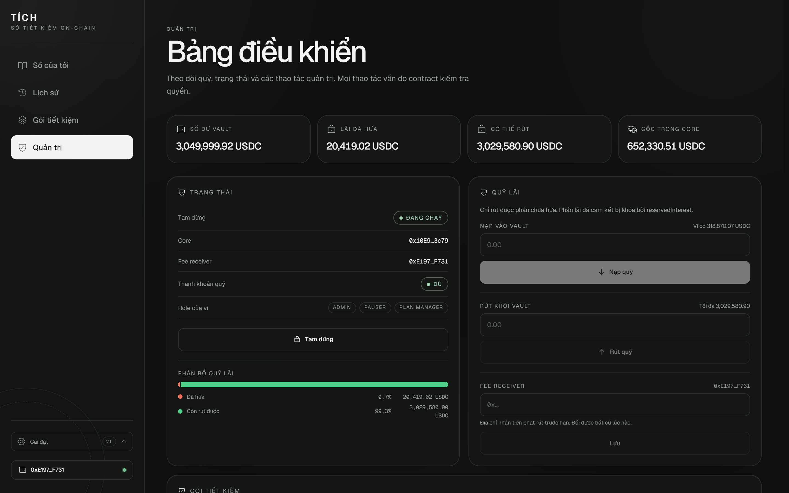
  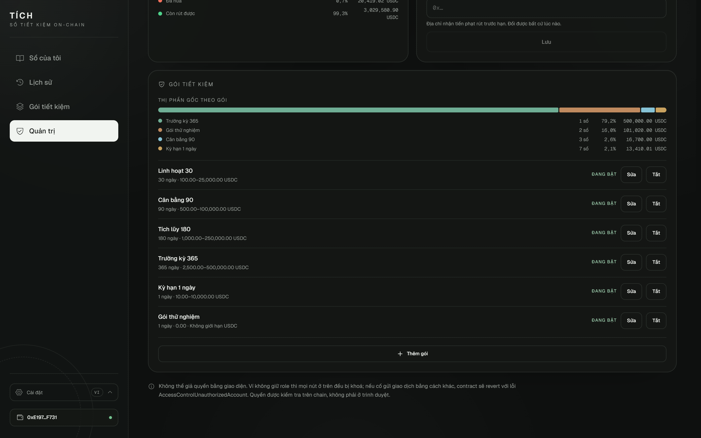
  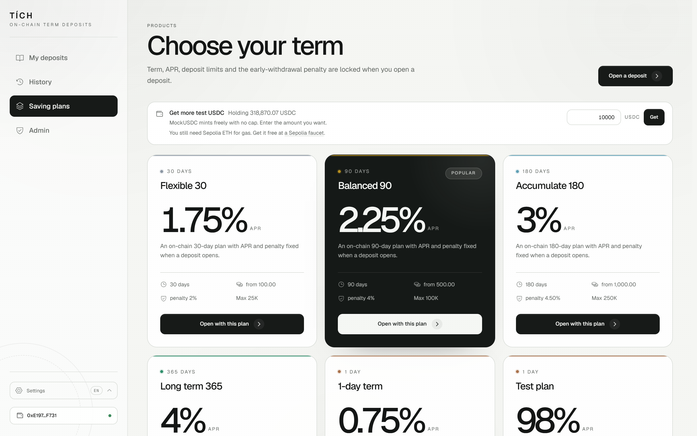
</p>
## Trạng thái hiện tại

| Phạm vi | Trạng thái |
| --- | --- |
| Mã nguồn và kiểm thử | Triển khai đủ C1–C4. 104/104 kiểm thử contract đạt, 49/49 test frontend đạt, 21/21 test keeper đạt, độ bao phủ contract 100% dòng và câu lệnh; `contracts:typecheck`, `build` và `lint` đều đạt. |
| Sepolia công khai | Triển khai ngày 2026-10-30 với 5 gói, nạp `100.000 USDC` vào vault và 12 giao dịch thiết lập (gas `2,929,946,052` wei). Cả ba contract đã được xác thực trên Etherscan; Sourcify đạt `exact_match` cho `VaultManager`/`SavingCore` và `match` cho `MockUSDC`. |
| Kiểm thử E2E trên Sepolia | Chưa chạy lại trên bộ địa chỉ hiện tại. Lần chạy `immediate` ngày 2026-10-29 thuộc bộ contract trước, đã ngừng dùng; cần chạy lại `npm run test:sepolia` để có bằng chứng cho bản này. |
| Walkthrough MetaMask | Chưa chạy lại trên bộ địa chỉ hiện tại; bản ghi ngày 2026-10-29 thuộc bộ contract trước. |

## Thông số cá nhân

MSSV **22665321** lấy hai chữ số cuối: `A = 1` (chữ số hàng đơn vị) và `B = 2` (chữ số hàng chục).

| Tham số | Công thức | Giá trị | Diễn giải |
| --- | --- | --- | --- |
| Grace period | `(A mod 3) + 2` ngày | 3 ngày (259.200 giây) | Thời gian chờ 3 ngày sau đáo hạn trước khi được auto-renew |
| APR mặc định | `200 + A × 25` bps | 225 bps = 2,25%/năm | 100 bps tương đương 1% |
| Phạt rút sớm | `300 + B × 50` bps | 400 bps = 4,00% | Tính trên phần gốc được rút ra |
| Kỳ hạn mặc định | `B` chẵn → 90 ngày | 90 ngày | Áp dụng cho gói mặc định |

Nguồn duy nhất là [contracts/config/personal.ts](contracts/config/personal.ts). Kiểm thử, script deploy và manifest đều đọc từ đây. Grace period là tham số constructor `immutable` nên không thể sửa sau khi deploy; muốn đổi MSSV phải triển khai bộ contract mới.

## Gói tiết kiệm

Mỗi gói (saving plan) là một sản phẩm do admin tạo, tương đương lời chào "gửi 90 ngày, APR 2,25%". Các trường lưu trong struct `SavingPlan`:

| Trường | Ý nghĩa |
| --- | --- |
| `tenorDays` | Thời gian gửi (7, 30, 90, 180, 365 ngày…) |
| `aprBps` | Lãi suất năm, tính theo basis points (225 = 2,25%/năm) |
| `minDeposit` / `maxDeposit` | Số tiền gửi tối thiểu / tối đa; `0` nghĩa là không giới hạn |
| `earlyWithdrawPenaltyBps` | Phạt rút sớm (400 = 4%), tính trên phần gốc bị rút |
| `enabled` | Admin có thể tắt gói để chặn mở sổ mới |

Khi mở sổ, `aprBps` và `earlyWithdrawPenaltyBps` được snapshot vào chứng chỉ NFT. Việc sửa gói về sau chỉ ảnh hưởng đến sổ mở mới, không thay đổi sổ đã tồn tại.

## Hàm admin

Admin quản lý hệ thống qua `VaultManager` và `SavingCore`; không thể sửa sổ đã mở.

| Hàm | Thuộc contract | Chức năng |
| --- | --- | --- |
| `createPlan(tenorDays, aprBps, minDeposit, maxDeposit, penaltyBps)` | `SavingCore` | Tạo gói tiết kiệm mới |
| `updatePlan(planId, newAprBps)` | `SavingCore` | Đổi APR; chỉ ảnh hưởng sổ mở sau đó |
| `setPlanEnabled(planId, enabled)` | `SavingCore` | Bật/tắt gói; chặn mở sổ mới khi tắt |
| `fundVault(amount)` | `VaultManager` | Nạp token vào vault để trả lãi |
| `withdrawVault(amount)` | `VaultManager` | Rút phần chưa hứa (`balance − reservedInterest`) |
| `setFeeReceiver(address)` | `VaultManager` | Đổi địa chỉ nhận tiền phạt rút sớm |
| `pause()` / `unpause()` | `VaultManager` | Dừng/khôi phục mọi giao dịch rút, mở sổ và nạp thêm |

## Công nghệ

| Lớp | Công nghệ | Phiên bản |
| --- | --- | --- |
| Runtime | Node.js | 22.22.2 (LTS) |
| Contract | Solidity / Hardhat | 0.8.38 / 3.21.1 |
| Contract | OpenZeppelin Contracts | 5.6.1 |
| Kiểm thử | Mocha / Chai / ethers | 12.0.3 / 6.3.0 / 6.17.0 |
| Frontend | React / Vite | 19.3.1 / 8.3.5 |
| Frontend | TypeScript / Tailwind CSS | 7.0.2 / 4.3.3 |
| Frontend | ethers / React Router | 6.17.0 / 7.18.5 |

`package.json` ở gốc yêu cầu `engines.node >= 22.12`, mức tối thiểu của Vite 8. Bộ kiểm thử và bản build đã chạy trên Node 22.22.2.

## Cài đặt

```powershell
npm install
npm --prefix contracts install
npm --prefix keeper install
npm --prefix frontend install
```

## Cấu hình frontend

`configure:frontend` chỉ nhận `testnet`, đọc [contracts/deployments/testnet.json](contracts/deployments/testnet.json) rồi ghi `frontend/.env.local`:

```powershell
npm run configure:frontend -- testnet
```

Nội dung được sinh ra cho bản đang sử dụng:

```text
VITE_CHAIN_ID=11155111
VITE_DEPLOY_BLOCK=12026923
VITE_CORE_ADDRESS=0x10E9eDb55C0cD100F67DEc8b558649e66B263c79
VITE_VAULT_ADDRESS=0x1c5533537118320021b5795473cb2552d11Bf9B5
VITE_USDC_ADDRESS=0x460193B776F34D63413d358203516CA44d78ecfE
```

Chỉ địa chỉ công khai và chain ID nằm trong biến `VITE_*`; private key không bao giờ đặt ở đây vì mọi biến có tiền tố `VITE_` đều được đóng gói vào bundle. MetaMask ký giao dịch trong trình duyệt. Nếu thiếu một trong ba địa chỉ, [config.ts](frontend/src/contracts/config.ts) báo lỗi cấu hình thay vì gọi contract.

## Khởi chạy giao diện

```powershell
npm run dev
```

Mở `http://127.0.0.1:5173/`, chọn **Kết nối ví**, chọn MetaMask (hoặc ví injected khác đang bật trong trình duyệt) và chuyển sang **Sepolia** (chain ID `11155111`, danh sách RPC có tại [chainlist.org/chain/11155111](https://chainlist.org/chain/11155111)). Khi ví chưa có Sepolia, giao diện tự đề nghị thêm mạng; nếu ví đang ở mạng khác, hộp thoại sai mạng xuất hiện ngay giữa màn hình, xóa dữ liệu cũ và có nút **Chuyển sang Sepolia**; không cần tải lại trang.

Thêm token để hiển thị số dư cạnh địa chỉ ví: contract `0x460193B776F34D63413d358203516CA44d78ecfE`, symbol `USDC`, decimals `6`. MockUSDC là token dùng cho kiểm thử và hàm `mint` mở công khai, nên ví chưa có tiền vẫn có thể nhận token: gọi `mint` trên Etherscan Write Contract với số lượng theo 6 decimals (1.000 USDC = `1000000000`). Ví cũng cần Sepolia ETH để trả phí gas; danh sách faucet có trong chainlist hoặc tại [sepoliafaucet.com](https://sepoliafaucet.com).

Luồng chính: tại **Gói tiết kiệm**, chọn kỳ hạn và mở sổ (lần đầu cần gọi `approve` cho USDC, sau đó gọi `openDeposit`); tại **Sổ của tôi**, xem NFT và thực hiện tất toán, rút trước hạn toàn bộ hoặc một phần, nạp thêm gốc, nhận lãi chờ hay tái gửi; tại **Lịch sử**, xem lại các sổ đã đóng kèm PnL thực nhận (chỉ đọc).

## Kiểm thử

```powershell
npm test
npm run test:frontend
npm run coverage
npm run contracts:typecheck
npm run build
npm run lint
```

Kết quả lần chạy gần nhất (2026-10-30):

```text
104 passing (contract)
31 passing (frontend, Vitest)
MockUSDC       100.00% lines / 100.00% statements
VaultManager   100.00% lines / 100.00% statements
SavingCore     100.00% lines / 100.00% statements
Total          100.00% lines / 100.00% statements
```

Bộ kiểm thử bao phủ các luồng bắt buộc và những trường hợp dễ phát sinh lỗi: thiếu allowance, snapshot APR sau khi sửa gói, mốc biên đáo hạn/grace, rút hai lần, pause chặn mọi cách rút, chuyển NFT đổi chủ, penalty 0/100%, lãi làm tròn xuống 0, top-up rồi tất toán, partial rồi renew/auto-renew và các ranh giới renew.

- **C1:** trả gốc và ghi nợ lãi khi vault thiếu tiền; claim sau khi nạp vault; claim đi theo NFT; pause chặn claim; sổ `PrincipalWithdrawn` không được dùng lại cho việc tất toán.
- **C2:** chỉ `SavingCore` giữ `CORE_ROLE`; admin không thể grant/revoke role sau khi khóa; reserve vượt số dư bị chặn; `withdrawVault` bị giới hạn ở `balance − reservedInterest`; khi vault mất dự trữ, admin không thể rút; release đúng khi rút sớm toàn bộ hoặc một phần.
- **C3:** 11 trường hợp rút sớm một phần.
- **C4:** nạp thêm giữa kỳ, nhiều lần nạp thêm, giảm gốc theo tỷ lệ và tái gửi sổ đã nạp thêm.

### E2E trên Sepolia thật

`contracts/scripts/e2e` gồm ba giai đoạn độc lập, lưu tiến độ trong `contracts/deployments/testnet.e2e.json` (đã ignore) và chỉ sử dụng chain ID `11155111`:

```powershell
npm run test:sepolia            # immediate
npm run test:sepolia:status     # đọc lại trạng thái, kiểm tra mốc thời gian
npm run test:sepolia:mature     # sau đáo hạn
npm run test:sepolia:auto-renew # sau đáo hạn + grace
```

Kết quả giai đoạn `immediate` ngày 2026-10-29 trên **bộ contract trước** (địa chỉ đã ngừng dùng): 19 giao dịch thật với tổng gas `77.866.819.359` wei. Script đã kiểm tra:

- Mở D1 gói 30 ngày `100 USDC`, nạp thêm `50 USDC`, rút sớm một phần `40 USDC` và chặn trường hợp phần còn lại thấp hơn mức tối thiểu.
- Pause vault chặn mở sổ, nạp thêm và rút sớm; unpause khôi phục trạng thái bình thường.
- `setCoreOnce` lần thứ hai, `grantRole(CORE_ROLE)` và `reserveInterest` từ deployer đều revert.
- `withdrawVault` vượt phần chưa hứa bị chặn; việc rút và hoàn lại `1 USDC` giữ nguyên số dư vault.
- Rút sớm toàn bộ D1; khoản phạt `2,2 USDC` (2% trên `110 USDC` còn lại) được chuyển đúng fee receiver.
- Mở T1–T6 gói 1 ngày; rút sớm một phần T2; nạp thêm gốc vào T3; chuyển NFT T4 sang tài khoản thứ hai.
- `reservedInterest` luôn bằng tổng lãi của các sổ đang hoạt động cộng với lãi chờ, và số dư vault luôn đủ để bảo đảm các khoản đã hứa.

Sổ T1 (chứng chỉ #2) đã được rút sớm trên chain lúc `2026-10-29 08:40 UTC` (tx [`0x09a8cc...2c94`](https://sepolia.etherscan.io/tx/0x09a8ccc2e70cdd4dd3a5d91a1b0ec6b4dae0c3362f15560f7d9d3abbe44c2c94)), ngoài kịch bản `immediate`; giai đoạn `mature` sẽ bỏ qua T1, tất toán T2–T4, tái gửi T6 sang gói 90 ngày và cho chủ mới của T4 rút. Giai đoạn `auto-renew` sẽ gia hạn T5 sau grace. `test:sepolia:status` in mốc thời gian sớm nhất của từng giai đoạn.

### Walkthrough giao diện với MetaMask

Ngày 2026-10-29, ví `0xE19750FC95F44bE27E4ec44F2779d2C38ba6F731` thao tác trực tiếp trên giao diện, mạng Sepolia:

- Mở sổ #8, gói 1 ngày, `20 USDC`, APR `0,50%`: tx [`0xcc27ba...9b78`](https://sepolia.etherscan.io/tx/0xcc27ba3cc38e3c573b629181591e1b46e7cb76cd3d8e1bdfc9de22b1cd799b78).
- Nạp thêm `10 USDC`, gốc mới `30 USDC`: tx [`0xddf627...9378`](https://sepolia.etherscan.io/tx/0xddf627314360b3192a4af405310fd417653a1953b276d41ae147fa27254a9378).
- Rút sớm một phần `10 USDC`, phạt `0,10 USDC`, còn `20 USDC`: tx [`0x3d4e93...e4a`](https://sepolia.etherscan.io/tx/0x3d4e93ed7453722f4247bc5e55e733cb1c221ad4b7b30b0bd2569354fed86e4a).
- Rút sớm toàn bộ `20 USDC`, phạt `0,20 USDC`, thực nhận `19,80 USDC`: tx [`0x37ec17...4a28`](https://sepolia.etherscan.io/tx/0x37ec175dd807d21e0e197085cef897128ce76895cf11af28ceae1908ae6a4a28).
- Đổi ngôn ngữ VI↔EN, giữ nguyên sau khi tải lại; kiểm tra trạng thái rỗng, trạng thái đang tải và lỗi số tiền dưới mức tối thiểu ở cả hai ngôn ngữ.

### Keeper tự động gia hạn

Mục 3.5 của đề yêu cầu một bot off-chain gọi `autoRenewDeposit`. Keeper là package độc lập ở [keeper/](keeper/README.md): không import Hardhat hay `contracts/`, chỉ cần Node và một RPC endpoint, nên copy nguyên folder lên VPS hoặc PaaS là chạy được. Mỗi lượt nó đọc toàn bộ sổ trong **một lần `eth_call`** (Multicall3) và chỉ chọn sổ `Active` có `block.timestamp >= maturityAt + gracePeriod`. `autoRenewDeposit` không giới hạn người gọi, nên ví bot không cần role, không cần USDC và không cần approve — chỉ cần ETH trả gas.

```powershell
npm --prefix keeper install
# tạo keeper/.env từ .env.example, hoặc lấy RPC_URL/KEEPER_PRIVATE_KEY từ contracts/.env
npm run keeper:start                              # một lượt
KEEPER_DRY_RUN=1 npm run keeper:start             # chỉ in, không gửi giao dịch
KEEPER_MODE=watch KEEPER_INTERVAL_SECONDS=300 npm run keeper:start
```

| Biến | Mặc định | Ý nghĩa |
| --- | --- | --- |
| `RPC_URL` | — | JSON-RPC endpoint, bắt buộc |
| `KEEPER_PRIVATE_KEY` | — | Khóa ví bot, bắt buộc |
| `CORE_ADDRESS` / `VAULT_ADDRESS` / `USDC_ADDRESS` | — | Địa chỉ contract; bỏ trống thì đọc `MANIFEST_PATH` |
| `KEEPER_MODE` | `watch` | `watch` treo chạy mãi; `once` chạy một lượt rồi thoát |
| `KEEPER_DRY_RUN` | `0` | `1` chỉ báo cáo, không gửi giao dịch |
| `KEEPER_INTERVAL_SECONDS` | `300` | Khoảng nghỉ giữa hai lượt ở chế độ `watch` |
| `KEEPER_MAX_RENEWALS_PER_RUN` | `10` | Chặn số giao dịch mỗi lượt để tránh cháy gas |
| `KEEPER_LOG_WAITING_LIMIT` | `0` | Số sổ đang chờ in mỗi lượt; `0` là in hết |
| `KEEPER_MAX_COST_ETH` | `0.005` | Trần chi phí gas cộng dồn trong một lượt |
| `KEEPER_MIN_BALANCE_RESERVE_ETH` | `0.005` | Số dư ETH tối thiểu phải giữ lại |
| `MAX_BASE_FEE_GWEI` / `MAX_FEE_GWEI` | `1` / `2` | Từ chối gửi khi base fee vượt ngưỡng; trần `maxFeePerGas` |

Ba lớp an toàn: `staticCall` mô phỏng trước khi gửi nên revert (chưa hết grace, hệ thống pause, vault thiếu lãi) bị chặn mà không tốn gas; mọi giao dịch đi qua gas guard tự kiểm tra nonce treo, trần phí, số dư dự trữ và đối chiếu receipt; lỗi ở một sổ không dừng cả lượt. Quyết định chọn sổ — ranh giới `maturityAt + gracePeriod`, loại sổ terminal, đọc cấu hình — được phủ bởi 20 test riêng của package (`npm run keeper:test`).

## Kiến trúc

| Contract | Lưu giữ | Chức năng chính |
| --- | --- | --- |
| `MockUSDC` | không giữ tiền | ERC-20 6 decimals; **không `Ownable`, không role, không cap** — `mint` mở cho mọi địa chỉ để ai cũng faucet được |
| `VaultManager` | tiền lãi của ngân hàng | nạp/rút vault, fee receiver, pause, reserve/release/pay interest |
| `SavingCore` | gốc của người gửi | gói, NFT chứng chỉ, snapshot, tất toán, claim, nạp thêm, rút sớm, tái gửi |
| `IVaultManager` | — | interface định nghĩa kiểu dữ liệu cho các lời gọi từ core sang vault |

Gốc và lãi được tách riêng để việc tất toán một sổ không phải lấy từ tiền gốc của những người gửi khác. `SavingCore` chỉ trả gốc đúng bằng khoản đã nhận khi mở sổ; mọi khoản lãi đều đi qua `VaultManager`. Với C1, nếu vault thiếu tiền tại thời điểm đáo hạn, gốc vẫn được trả ngay và lãi được ghi nợ trong `pendingInterest`; chủ NFT hiện tại gọi `claimInterest` khi vault có tiền. Tái gửi vẫn mang tính nguyên tử: nếu vault thiếu lãi, toàn bộ giao dịch tái gửi revert.

Mỗi sổ lưu `principal`, `aprBpsAtOpen`, `penaltyBpsAtOpen`, `tenorDays`, `openedAt`, `maturityAt`, `status` và `principalSeconds`; sửa gói về sau chỉ ảnh hưởng sổ mới.

```text
mở sổ:      principalSeconds = principal × tenorDays × 1 ngày
nạp thêm:   principalSeconds += amount × (maturityAt − block.timestamp)
interest    = principalSeconds × aprBpsAtOpen / (365 × 86_400 × 10_000)
penalty     = amount × penaltyBpsAtOpen / 10_000
```

Năm trạng thái: `Active`, `Withdrawn`, `ManualRenewed`, `AutoRenewed`, `PrincipalWithdrawn`. Ba cách kết thúc sổ là tất toán, rút sớm toàn bộ và tái gửi thủ công; cả ba đều kiểm tra `status == Active` và `ownerOf(depositId) == msg.sender`. `topUpDeposit` chỉ áp dụng cho sổ `Active` trước đáo hạn. `claimInterest` chỉ áp dụng cho sổ `PrincipalWithdrawn`.

### Sự kiện

Năm sự kiện bắt buộc theo đề bài, cùng các sự kiện bổ trợ cho C1–C4:

| Sự kiện | Contract | Ý nghĩa |
| --- | --- | --- |
| `PlanCreated(planId, tenorDays, aprBps)` | `SavingCore` | Tạo gói mới |
| `PlanUpdated(planId, newAprBps)` | `SavingCore` | Đổi APR gói; chỉ ảnh hưởng sổ sau |
| `PlanStatusChanged(planId, enabled)` | `SavingCore` | Bật/tắt gói |
| `DepositOpened(depositId, owner, planId, principal, maturityAt, aprBpsAtOpen)` | `SavingCore` | Mở sổ, mint NFT |
| `Withdrawn(depositId, owner, principal, interest, isEarly)` | `SavingCore` | Tất toán hoặc rút sớm toàn bộ |
| `Renewed(oldDepositId, newDepositId, newPrincipal, newPlanId)` | `SavingCore` | Tái gửi thủ công hoặc auto-renew |
| `PartialEarlyWithdrawn(depositId, owner, amount, penalty, remainingPrincipal)` | `SavingCore` | Rút sớm một phần (C3) |
| `DepositToppedUp(depositId, owner, amount, newPrincipal, interestAdded)` | `SavingCore` | Nạp thêm gốc (C4) |
| `InterestDeferred(depositId, owner, amount)` | `SavingCore` | Ghi nợ lãi khi vault thiếu tiền (C1) |
| `InterestClaimed(depositId, owner, amount)` | `SavingCore` | Nhận lãi chờ (C1) |
| `VaultFunded(funder, amount)` | `VaultManager` | Nạp tiền vào vault |
| `VaultWithdrawn(recipient, amount)` | `VaultManager` | Rút phần chưa hứa |
| `FeeReceiverUpdated(previousReceiver, newReceiver)` | `VaultManager` | Đổi fee receiver |
| `InterestReserved(amount, totalReserved)` | `VaultManager` | Reserve lãi khi mở sổ/nạp thêm (C2) |
| `InterestReleased(amount, totalReserved)` | `VaultManager` | Giải trừ khi rút sớm (C2) |
| `InterestPaid(recipient, amount)` | `VaultManager` | Trả lãi cho người gửi |
| `CoreRoleLocked(core)` | `VaultManager` | Khóa `CORE_ROLE` sau `setCoreOnce` (C2) |

## Design Answers

Bảy câu dưới đây ứng với mục 8.2 của đề. Mỗi câu trình bày quy tắc, quyết định trong code và đánh đổi.

### 1. Nếu Alice chuyển nhượng NFT cho Bob thì ai có quyền rút?

Bob. Vì chứng chỉ là NFT, quyền rút thuộc về người đang sở hữu NFT. `_requireActiveOwner` kiểm tra `ownerOf(depositId) == msg.sender` trong `withdrawAtMaturity`, `earlyWithdraw`, `earlyWithdrawPartial` và `renewDeposit`; `claimInterest` kiểm tra chủ NFT riêng; `topUpDeposit` dùng chung `_requireActiveOwner`. Auto-renew mint sổ mới cho chủ NFT hiện tại. Nếu Alice gọi sau khi đã chuyển nhượng, giao dịch sẽ revert với lỗi `Core: not certificate owner`.

Đánh đổi: nếu mất ví hoặc chuyển nhầm, quyền rút cũng mất và ngân hàng không thể can thiệp. Ngược lại, người cần tiền gấp có thể bán sổ trên thị trường thứ cấp thay vì chịu mức phạt 4%.

### 2. Điều gì xảy ra nếu vault thiếu tiền tại thời điểm đáo hạn?

Gốc vẫn được trả ngay, còn lãi được ghi nợ và nhận sau (C1). `withdrawAtMaturity` bọc lời gọi `vault.payInterest` trong `try/catch`; nếu vault revert, sổ chuyển sang `PrincipalWithdrawn`, lãi được ghi vào `pendingInterest[depositId]`, phát sự kiện `InterestDeferred` và gốc vẫn được trả đủ. Chủ NFT hiện tại gọi `claimInterest` khi vault được nạp tiền. Hàm xóa khoản nợ trước khi gọi vault; nếu vault vẫn thiếu tiền, toàn bộ giao dịch revert và người dùng có thể thử lại. Claim cũng bị chặn khi hệ thống pause.

Đánh đổi: lãi chờ không tự động chuyển vào ví nên người dùng phải quay lại claim; frontend hiển thị trạng thái `CHỜ LÃI`. Tái gửi thủ công và auto-renew vẫn theo cơ chế tất cả hoặc không (all-or-nothing) vì cần lãi để tạo gốc mới.

### 3. Nếu bot tự động gia hạn ngừng hoạt động một tháng thì ai chịu thiệt hại?

Không ai mất tiền. Bot chỉ gọi hàm gia hạn thay người dùng: sổ cũ giữ nguyên trạng thái `Active`, không bị xóa và không mất phần lãi đã được ghi nhận. Người dùng vẫn có thể tự rút bằng `withdrawAtMaturity` hoặc tái gửi bằng `renewDeposit` bất cứ lúc nào sau đáo hạn. Vì `autoRenewDeposit` cho phép bất kỳ địa chỉ nào gọi sau mốc đáo hạn cộng grace, ví của người dùng hoặc bên thứ ba đều có thể thay bot.

Tác động duy nhất là khoản tiền tiếp tục nằm trong sổ thêm một tháng thay vì được gia hạn. Repo có keeper ở [keeper/](keeper/README.md) để chạy thay bot; vì `autoRenewDeposit` không giới hạn người gọi, một keeper thứ hai hoặc chính người dùng đều có thể thay thế khi bot chính ngừng.

### 4. Phần dư khi chia lãi được xử lý như thế nào?

Đối với lãi, phần dư nằm lại trong vault; đối với phạt, phần dư được trả lại cùng gốc cho người rút. Cả hai dùng `Math.mulDiv` trong `_interestFor` và `_penaltyFor`: nhân trước chia sau và luôn làm tròn xuống, nên số phải trả chỉ nhỏ đi chứ không bao giờ âm. Khoản lãi 2,777... USDC được trả 2,77 USDC; phần dưới một đơn vị 6 decimals ở lại vault.

Trường hợp lãi làm tròn về 0 cũng không gây mắc kẹt: `withdrawAtMaturity` có `if (interest > 0)` nên bỏ qua vault và trả đủ gốc. Kiểm thử mở sổ 1 đơn vị với APR 1 bps, kỳ hạn 1 ngày và vẫn rút gốc bình thường. Không có sổ kế toán riêng nên phần dư không thể bị rút hai lần.

### 5. Giao dịch tại đúng thời điểm đáo hạn được tính là rút sớm hay đúng hạn?

Được tính là rút đúng hạn. Trước `maturityAt` là rút sớm; từ mốc đó trở đi là đúng hạn, không tồn tại khoảng chuyển tiếp. `withdrawAtMaturity` và `renewDeposit` dùng `>=`; `earlyWithdraw` và `earlyWithdrawPartial` dùng `<`. Việc dùng `>=` bảo đảm người tất toán đúng thời điểm đáo hạn không bị tính phạt sai.

Auto-renew yêu cầu `block.timestamp >= maturityAt + gracePeriod`, nên đúng mốc hết grace là có thể gia hạn. Người dùng vẫn tái gửi thủ công được ở giây cuối của grace nếu bot chưa chạy, vì `renewDeposit` chỉ yêu cầu `>= maturityAt` và không phụ thuộc grace.

### 6. Điều gì xảy ra nếu admin tắt gói trong khi vẫn còn sổ đang hoạt động?

Sổ đang hoạt động không bị ảnh hưởng. Khi mở sổ, contract đã lưu snapshot APR, kỳ hạn và mức phạt vào chính sổ đó, nên việc sửa hay tắt gói về sau chỉ ảnh hưởng đến các sổ mở mới. `setPlanEnabled` chỉ thay đổi cờ `enabled`. Người có sổ cũ vẫn tất toán, rút sớm toàn bộ hoặc một phần theo mức cũ, hoặc tái gửi sang gói khác đang mở.

Hai ngoại lệ: tái gửi thủ công vào gói đã tắt bị chặn vì `renewDeposit` yêu cầu `newPlan.enabled`; auto-renew vẫn dùng gói gốc vì đó là cam kết với người gửi cũ. Nạp thêm vẫn được phép trên gói đã tắt: `topUpDeposit` không mở sổ mới và mọi điều khoản đã snapshot trong sổ, nên việc tắt gói chỉ chặn vốn mới.

### 7. Một kịch bản tấn công thực tế và cách phòng chống

Kịch bản: rút tiền hai lần, bao gồm trường hợp gọi lồng trong khi giao dịch đầu tiên chưa hoàn tất (reentrancy). Bốn lớp phòng chống:

1. Tám hàm có tác động đến tiền (`openDeposit`, `withdrawAtMaturity`, `claimInterest`, `topUpDeposit`, `earlyWithdraw`, `earlyWithdrawPartial`, `renewDeposit`, `autoRenewDeposit`) đều được gắn `nonReentrant`.
2. Trạng thái được cập nhật trước khi chuyển tiền, nên lần rút thứ hai dừng tại `_requireActiveOwner` với lỗi `Core: deposit inactive`. `claimInterest` xóa `pendingInterest` trước khi gọi vault; `earlyWithdrawPartial` giảm `principal` và `principalSeconds` trước khi chuyển tiền.
3. `VaultManager` chỉ chấp nhận lệnh từ `SavingCore`; `asset` và `vault` là `immutable` nên không thể bị thay thế bằng contract giả sau khi deploy.
4. C2 duy trì `reservedInterest`; `withdrawVault` chỉ cho rút phần chưa hứa và `payInterest` từ chối khoản chưa reserve. `setCoreOnce` khóa `CORE_ROLE` và `reserveInterest` bắt buộc khoản reserve phải có tiền thật.

Hạn chế còn lại: reservation chỉ là sổ kế toán trong cùng vault, không phải escrow riêng; admin vẫn là vai trò tin cậy đối với gói, pause, fee receiver và phần chưa hứa. Để giảm mức độ tin cậy cần dùng multisig/timelock.

## Creative Challenge C1 — Trả gốc ngay, ghi nợ lãi

**Vấn đề.** Đề bài yêu cầu `withdrawAtMaturity` revert nếu vault thiếu lãi, khiến tiền gốc của người gửi bị khóa bởi khoản nợ lãi của ngân hàng, dù gốc vẫn nằm đủ trong `SavingCore`.

**Cách làm.** `withdrawAtMaturity` bọc `vault.payInterest` trong `try/catch`. Nếu vault trả được, sổ thành `Withdrawn`. Nếu không, sổ thành `PrincipalWithdrawn`, lãi vào `pendingInterest` và phát sự kiện `InterestDeferred`; gốc vẫn chuyển ngay. `claimInterest` cho chủ NFT hiện tại nhận đúng khoản đã ghi nợ, xóa nợ trước khi gọi vault và bị chặn khi pause. Khoản chờ vẫn nằm trong `reservedInterest` nên C2 không cho admin rút.

**Đánh đổi.** Người dùng phải quay lại claim; sổ đã trả gốc không dùng để tái gửi hay rút tiếp; renew/auto-renew vẫn revert khi vault thiếu lãi.

**Kiểm thử.** Năm trường hợp: trả gốc và ghi nợ, claim sau khi nạp vault, claim đi theo NFT, pause chặn claim, sổ `PrincipalWithdrawn` không được dùng lại cho việc tất toán. Vault được nạp đủ nên C1 kiểm chứng qua bộ kiểm thử đơn vị, nơi dựng được tình huống vault thiếu tiền mà không phá C2.

## Creative Challenge C2 — Khóa phần lãi đã hứa

**Vấn đề.** Nếu admin rút tự do, admin có thể rút đúng khoản lãi đang nợ các sổ hoạt động. Người gửi vẫn thấy lãi dự kiến trên giao diện nhưng đến đáo hạn mới biết vault trống.

**Cách làm.**

- `VaultManager` lưu `reservedInterest`, cộng dồn mọi khoản lãi đã hứa.
- `SavingCore` gọi `reserveInterest` khi mở sổ và khi nạp thêm; gọi `releaseInterest` khi rút sớm toàn bộ hoặc giảm gốc một phần; `payInterest` trừ reservation khi trả lãi.
- `withdrawVault` chỉ cho admin rút `balance − reservedInterest`; nếu `balance < reservedInterest` thì revert `Vault: undercollateralized`.
- `setCoreOnce(address)` cấp `CORE_ROLE` cho `SavingCore` đúng một lần, rồi đặt admin của `CORE_ROLE` thành chính `CORE_ROLE`. Sau đó `DEFAULT_ADMIN_ROLE` không grant/revoke `CORE_ROLE` được nữa.
- `reserveInterest` từ chối nếu `reservedInterest + amount > vault balance`, nên invariant `balance >= reservedInterest` được giữ ngay từ lúc reserve.

**Đánh đổi.**

- Vault phải được nạp đủ trước khi mở sổ hoặc nạp thêm; nếu không, giao dịch revert thay vì ghi một khoản lãi không có tiền.
- Đây vẫn là sổ kế toán, không phải escrow riêng. Nếu token bị mất hoặc bị tấn công khỏi vault, điều kiện bất biến bị vi phạm; khi đó `withdrawVault` bị chặn và C1 vẫn bảo vệ gốc.
- Admin vẫn là vai trò tin cậy đối với gói, pause, fee receiver và phần chưa hứa.

**Kiểm thử.** Các trường hợp trong `VaultManager.ts` kiểm tra khóa role, thiết lập một lần, reserve vượt số dư, giới hạn rút của admin, vault mất dự trữ và release khi rút sớm. Các trường hợp mở sổ, nạp thêm và tất toán trong `SavingCore.ts` cũng kiểm tra `reservedInterest` tăng/giảm tương ứng.

**Trạng thái Sepolia.** Bản `0x10E9eDb5…3c79` đã có đầy đủ C2: `setCoreOnce`, `CORE_ROLE` bị khóa, dự trữ bảo đảm và giới hạn rút. Giai đoạn `immediate` đã kiểm tra trên chain thật.

## Creative Challenge C3 — Rút sớm một phần

**Vấn đề.** `earlyWithdraw` chỉ hỗ trợ rút toàn bộ: dù chỉ cần một phần nhỏ, người gửi vẫn phải đóng cả sổ và chịu phạt 4% trên toàn bộ gốc.

**Cách làm.** `earlyWithdrawPartial` chỉ chạy trước `maturityAt`, khi sổ `Active` và ví gọi là chủ NFT hiện tại. Phạt tính trên đúng phần rút; phần còn lại `principal - amount` phải `>= minDeposit` của gói, nếu không revert `Core: remaining below minimum`. APR, penalty, tenor và `maturityAt` giữ nguyên; NFT giữ nguyên, chỉ giảm `principal`. Phần đã rút không sinh lãi; lãi đáo hạn tính trên phần còn lại. Sự kiện: `PartialEarlyWithdrawn(depositId, owner, amount, penalty, remainingPrincipal)`.

Ví dụ: sổ 1.000 USDC thuộc gói có mức tối thiểu 500 USDC; rút sớm 200 USDC thì phạt 8 USDC, nhận 192 USDC, phần còn lại 800 USDC tiếp tục đến ngày đáo hạn cũ. Với sổ 500 USDC, rút 200 USDC sẽ để lại 300 USDC, thấp hơn mức tối thiểu 500 USDC nên giao dịch revert; muốn rút phải dùng `earlyWithdraw` toàn bộ.

**Đánh đổi.** Không tách khoản gửi thành nhiều phần riêng: một NFT và một `depositId`, lịch sử đọc từ sự kiện. Không thể rút số tiền khiến phần còn lại thấp hơn mức tối thiểu. Lãi tương lai giảm theo phần gốc còn lại.

**Kiểm thử.** 11 trường hợp: penalty trên phần rút, giữ snapshot, mức tối thiểu còn lại, owner/NFT, pause, penalty 0/100%, lãi đáo hạn trên phần còn lại và rút toàn bộ sau khi rút một phần. Frontend đã tích hợp: mặc định rút toàn bộ, nhập số nhỏ hơn thì gọi `earlyWithdrawPartial`.

## Creative Challenge C4 — Nạp thêm vào sổ đang chạy

**Vấn đề.** Sổ đã mở không hỗ trợ gửi thêm: muốn gửi thêm phải mở sổ mới, mất ngày đáo hạn cũ và phải áp dụng APR mới.

**Cách làm.** `Deposit` thêm `principalSeconds`. Lúc mở sổ, giá trị bằng `principal × tenorDays × 1 ngày`; lãi tính bằng `principalSeconds × aprBpsAtOpen / (365 ngày × 10.000)`. `topUpDeposit` chỉ chạy khi sổ `Active`, trước đáo hạn, đúng chủ NFT và hệ thống không pause. Contract nhận thêm gốc, cộng `amount × (maturityAt − block.timestamp)` vào `principalSeconds`, rồi reserve đúng phần lãi tăng thêm. Kỳ hạn, APR, penalty và `maturityAt` giữ nguyên; không mint NFT mới và không đổi `depositId`. `principalSeconds` giảm theo tỷ lệ khi rút sớm một phần, nên phần đã rút không tiếp tục sinh lãi.

Ví dụ: sổ 1.000 USDC kỳ hạn 90 ngày, nạp thêm 500 USDC sau 30 ngày. Khoản 500 USDC mới chỉ sinh lãi cho 60 ngày còn lại. Giới hạn `maxDeposit` của gói gốc vẫn áp dụng trên tổng gốc sau khi nạp thêm.

**Đánh đổi.** Không tách thành các phần riêng: lịch sử nạp thêm được đọc từ sự kiện `DepositToppedUp` và mọi khoản gốc dùng chung một snapshot APR. Không thể nạp thêm sau đáo hạn. Nếu rút sớm sau đó, mức phạt được tính trên toàn bộ gốc còn lại theo snapshot ban đầu.

**Ranh giới.** `maxDeposit` được kiểm tra khi mở sổ và khi nạp thêm, nhưng không kiểm tra lại ở `renewDeposit` và `autoRenewDeposit`. Với `renewDeposit` sang gói khác, `minDeposit` của gói mới cũng không được kiểm tra: gốc mới bằng gốc cũ cộng lãi, nên nếu gói mới có mức tối thiểu cao hơn, sổ mới có thể nằm dưới min. Với `autoRenewDeposit`, gói gốc được dùng lại nên min luôn đạt, nhưng gốc mới có thể vượt `maxDeposit` một chút. Bản này chấp nhận ranh giới đó vì chặn tái gửi sẽ khóa sổ đã đáo hạn; `maxDeposit` được hiểu là giới hạn cho vốn mới. Nếu muốn chặn, thêm kiểm tra min/max trong `renewDeposit` và test revert tương ứng.

**Kiểm thử.** Bốn trường hợp: nạp thêm giữa kỳ với lãi theo principal-seconds và reserve tăng đúng, chặn sai chủ/giá trị 0/vượt mức tối đa/pause/sau đáo hạn, giảm theo tỷ lệ sau khi rút sớm một phần, và tái gửi sổ đã nạp thêm.

## Triển khai lên Sepolia

Mạng `testnet` được cố định ở chain ID `11155111`; repo không có script deploy local, fork hoặc bản deploy song song. Mạng in-process của Hardhat (`31337`) chỉ dùng cho kiểm thử đơn vị. Deploy cần `TESTNET_RPC_URL` và `DEPLOYER_PRIVATE_KEY`; xác thực mã nguồn cần thêm `ETHERSCAN_API_KEY`. Có thể đặt trong `contracts/.env` (đã ignore) hoặc truyền riêng cho phiên PowerShell:

```powershell
$env:TESTNET_RPC_URL='https://ethereum-sepolia-rpc.publicnode.com'
$env:DEPLOYER_PRIVATE_KEY='0x...'
$env:FEE_RECEIVER_ADDRESS='0x...'                     # tùy chọn, mặc định là deployer
$env:EXPLORER_BASE_URL='https://sepolia.etherscan.io'  # tùy chọn, chỉ ghi vào manifest
$env:ETHERSCAN_API_KEY='...'                           # chỉ cần khi xác thực mã nguồn

npm run deploy:testnet:dry   # ước lượng gas, không gửi giao dịch
npm run deploy:testnet
npm run verify:testnet
npm run configure:frontend -- testnet
```

`deploy:testnet:dry` chỉ đọc RPC và in chi phí trong trường hợp xấu nhất. `verify:testnet` đối chiếu manifest với chain thật: chain ID, địa chỉ sinh ra từ receipt, nonce liên tục, phạm vi block, gas, bytecode tồn tại, liên kết token–vault–core, `vault.core()`, admin của `CORE_ROLE` đã bị khóa, fee receiver, grace period, kỳ hạn/hạn mức/phạt của 5 gói trong manifest, khoản nạp vào vault và `reservedInterest <= vault balance`. Sau khi e2e đã mở sổ, thêm `ALLOW_POST_E2E=1` để bỏ qua các kiểm tra snapshot của lần deploy mới. Cờ này cũng bỏ qua APR, trạng thái bật/tắt và số lượng gói, vì `updatePlan`, `setPlanEnabled` và `createPlan` được phép thay đổi chúng sau khi deploy. Script cần RPC còn giữ receipt cũ (publicnode đã prune, tenderly thì còn).

Xác thực mã nguồn được chạy trong `contracts/`:

```powershell
npx hardhat verify --network testnet <MockUSDC>
npx hardhat verify --network testnet <VaultManager> <MockUSDC> <admin> <feeReceiver>
npx hardhat verify --network testnet <SavingCore> <MockUSDC> <VaultManager> 259200
```

### Triển khai đang sử dụng

| Contract | Địa chỉ trên Sepolia |
| --- | --- |
| `MockUSDC` | [`0x460193B776F34D63413d358203516CA44d78ecfE`](https://sepolia.etherscan.io/address/0x460193B776F34D63413d358203516CA44d78ecfE#code) |
| `VaultManager` | [`0x1c5533537118320021b5795473cb2552d11Bf9B5`](https://sepolia.etherscan.io/address/0x1c5533537118320021b5795473cb2552d11Bf9B5#code) |
| `SavingCore` | [`0x10E9eDb55C0cD100F67DEc8b558649e66B263c79`](https://sepolia.etherscan.io/address/0x10E9eDb55C0cD100F67DEc8b558649e66B263c79#code) |

Deployer kiêm fee receiver: [`0xE19750FC95F44bE27E4ec44F2779d2C38ba6F731`](https://sepolia.etherscan.io/address/0xE19750FC95F44bE27E4ec44F2779d2C38ba6F731). Contract deploy ở block `12026923`; 12 giao dịch thiết lập kết thúc ở block `12026936`, tổng gas `2,929,946,052` wei (≈ `0,0000033` ETH). Manifest đầy đủ ở [contracts/deployments/testnet.json](contracts/deployments/testnet.json).

Năm gói trên chain:

| Plan | Kỳ hạn | APR | Tối thiểu | Tối đa | Phạt sớm |
| --- | --- | --- | --- | --- | --- |
| 1 | 30 ngày | 1,75% | 100 USDC | 25.000 USDC | 2,00% |
| 2 | 90 ngày | 2,25% | 500 USDC | 100.000 USDC | 4,00% |
| 3 | 180 ngày | 3,00% | 1.000 USDC | 250.000 USDC | 4,50% |
| 4 | 365 ngày | 4,00% | 2.500 USDC | 500.000 USDC | 5,00% |
| 5 | 1 ngày | 0,50% | 10 USDC | 10.000 USDC | 1,00% |

Giao dịch deploy và thiết lập (block `12026923`–`12026936`, tổng gas `2,929,946,052` wei ≈ `0,0000029` ETH):

- Deploy `MockUSDC`: [`0x4ee113…a1d17`](https://sepolia.etherscan.io/tx/0x4ee11388af6d3f7ad5933a766e7d1d643ff6af68db590cdcb50d57f631fa1d17)
- Deploy `VaultManager`: [`0x799f54…9eb29`](https://sepolia.etherscan.io/tx/0x799f5499ec0ce87e7bbd4a9fd4f9a4820a2b4fd66a3e806ac7fad9a06f99eb29)
- Deploy `SavingCore`: [`0x95a234…aaa83`](https://sepolia.etherscan.io/tx/0x95a23485b6852266b6f7f2e94dac4b38a17008a40b34f79d9be732a56adaaa83)
- `setCoreOnce`: [`0x2be2b9…e4012`](https://sepolia.etherscan.io/tx/0x2be2b9c4f10dd1e71141a50cc13007a1c4b48fc3f807ce0cb75ceb67f82e4012)
- Mint `150.000 USDC` + approve + nạp `100.000 USDC` vào vault: [`0x5653c4…3a533`](https://sepolia.etherscan.io/tx/0x5653c4068d55a93da923d342d86c4314d47595842c97e7a43c919f2cc593a533), [`0x4e4f71…3c483`](https://sepolia.etherscan.io/tx/0x4e4f7185424ba27132f5a9f2d39e6030e983980ed5ffa35c511f96dabb23c483), [`0x813d3d…d395a`](https://sepolia.etherscan.io/tx/0x813d3db1861e548c2436bcc19c64343a47585c9a98473c17dc5b3745cd7d395a)
- Tạo 5 gói (plan 1–5): [`0x2ccc21…2796f`](https://sepolia.etherscan.io/tx/0x2ccc213970458535d04b1db4f39686bd3c337937f3260313a71c60b11f02796f), [`0x854539…99b45`](https://sepolia.etherscan.io/tx/0x8545390fb6e32281267c5ae1991f6f39895d5e1d9d6f0e6813f4faa293b99b45), [`0xa3e862…5764c`](https://sepolia.etherscan.io/tx/0xa3e8620ed2ce165924d653f8d39df8c70a888926e6c1504095f21e37d305764c), [`0x1ae613…4eff0`](https://sepolia.etherscan.io/tx/0x1ae6132ebafcc6b2e677821c90714f7f2757c335cf9248b77ab0613ce954eff0), [`0x17fe35…3eb98`](https://sepolia.etherscan.io/tx/0x17fe35544f844c2db017639a50c76ce7cdbc13f8115fb09fae3277d2b2a3eb98)

Giai đoạn e2e `immediate` **chưa chạy lại** trên bộ địa chỉ này. Lần chạy 2026-10-29 thuộc bộ contract đã ngừng dùng, state cũ lưu ngoài repo; `mature` và `auto-renew` vẫn chờ thời gian chain thật.

## Deliverables

| Thành phần | Mô tả |
| --- | --- |
| Smart Contracts | `MockUSDC.sol` (ERC-20, 6 decimals, mint công khai), `VaultManager.sol` (vault, fee receiver, pause, reserve/release/pay), `SavingCore.sol` (gói, NFT, snapshot, tất toán, claim, nạp thêm, rút sớm, tái gửi). Interface `IVaultManager` định nghĩa kiểu dữ liệu cho lời gọi từ core sang vault. |
| Kiểm thử | 89 kiểm thử Hardhat (contract) + 31 kiểm thử Vitest (frontend) + 20 kiểm thử keeper, độ bao phủ contract 100% dòng và câu lệnh. Bao phủ đầy đủ luồng bắt buộc và trường hợp biên: thiếu allowance, snapshot APR sau sửa gói, mốc đáo hạn/grace, rút hai lần, pause chặn mọi đường rút, chuyển NFT đổi chủ, penalty 0/100%, lãi làm tròn xuống 0. |
| Frontend | React + TypeScript + Tailwind, kết nối ví injected qua EIP-6963 (MetaMask mặc định). Bốn luồng yêu cầu: xem gói, mở sổ, xem sổ, rút/tái gửi — cùng C1 (claim lãi chờ), C3 (rút sớm một phần), C4 (nạp thêm gốc). Song ngữ Việt–Anh, trạng thái kết nối/tải/rỗng/lỗi đầy đủ. |
| Keeper auto-renew | Package độc lập `keeper/` quét sổ đã hết grace và gọi `autoRenewDeposit`; chạy một lượt hoặc `watch`, có dry-run, trần gas và mô phỏng `staticCall` trước khi gửi. Copy folder lên VPS là chạy, không cần Hardhat. |
| Design Answers | Bảy câu trả lời trong README, đối ứng mục 8.2 đề bài, trình bày quy tắc, quyết định trong code và đánh đổi. |
| Thông số cá nhân | MSSV `22665321` → `A=1`, `B=2`, grace 3 ngày, APR 225 bps, phạt 400 bps, kỳ hạn 90 ngày. Nguồn duy nhất: [contracts/config/personal.ts](contracts/config/personal.ts). |
| Creative Challenges | C1 (trả gốc ngay, ghi nợ lãi), C2 (khóa lãi đã hứa), C3 (rút sớm một phần), C4 (nạp thêm gốc). Mỗi challenge có kiểm thử riêng và ghi chú problem/approach/trade-off/tests trong README. |
| Demo video | Video 3–5 phút walkthrough giao diện theo mục 11 của đề. |

## Lệnh thường dùng

| Lệnh | Chức năng |
| --- | --- |
| `npm run dev` | chạy Vite tại cổng 5173 |
| `npm run build` | kiểm tra kiểu và build bản production cho frontend |
| `npm run lint` | chạy oxlint |
| `npm test` | chạy 89 kiểm thử Hardhat |
| `npm run coverage` | chạy test kèm báo cáo coverage |
| `npm run contracts:typecheck` | kiểm tra TypeScript phần contract |
| `npm run contracts:compile` | compile contract bằng Hardhat |
| `npm run contracts:export-abis` | compile rồi sinh lại `frontend/src/contracts/abis.ts` |
| `npm run deploy:testnet:dry` | ước lượng gas deploy trên Sepolia, không gửi giao dịch |
| `npm run deploy:testnet` | deploy lên Sepolia |
| `npm run verify:testnet` | xác thực deployment Sepolia |
| `npm run configure:frontend -- testnet` | ghi `frontend/.env.local` từ manifest |
| `npm run test:sepolia` | chạy giai đoạn `immediate` trên Sepolia thật |
| `npm run test:sepolia:status` | đọc trạng thái và mốc thời gian của các giai đoạn |
| `npm run test:sepolia:mature` | chạy giai đoạn tất toán/tái gửi sau đáo hạn |
| `npm run test:sepolia:auto-renew` | chạy giai đoạn auto-renew sau grace |
| `npm run keeper:start` | keeper bot gia hạn các sổ đã hết grace (`KEEPER_MODE`, `KEEPER_DRY_RUN`) |
| `npm run keeper:test` | chạy 20 test của package keeper |

Toàn bộ deploy, xác thực, e2e và keeper đều được cố định ở chain ID `11155111`; repo không có script deploy local, fork hoặc deploy song song. Mạng in-process `31337` chỉ phục vụ kiểm thử đơn vị.
